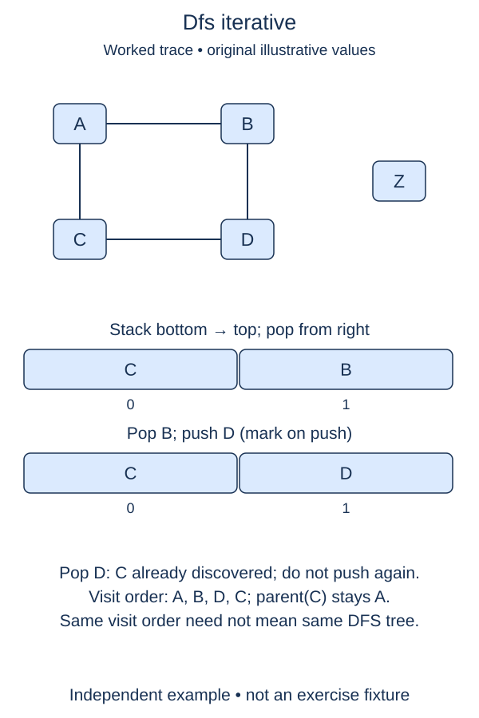

Match recursive DFS order without using the Python call stack.

A recursive call remembers more than a vertex: it remembers which neighbor to examine next when a deeper call returns. An iterator preserves that position. `iter(adj[vertex])` creates one, and `next(iterator, None)` returns its next label or the supplied sentinel when it is exhausted. Labels are strings, so `None` cannot be a vertex here.

The explicit stack holds these suspended iterators. Its last item is the currently active frame. Read one neighbor from it. If no neighbor remains, pop that frame and resume its caller. If the label is unseen, record it and push its neighbor iterator. That new frame becomes active immediately, just as a recursive call would.

The start is already marked and recorded by the supplied setup. The small `remember_neighbor` helper changes the discovery set, while the separate output checkpoint appends to the visit list. Your edits handle the repeating operations. A temporary break in the starter prevents an unfinished exhausted-frame operation from looping forever. The supplied loop calls `finish_frame`, checks that it shortened the stack, and resumes its caller.

Simply pushing every neighbor in reverse order is not always equivalent to recursive DFS on a graph. If you eagerly mark all siblings before exploring the first one, a cross-edge into a waiting sibling can change the discovery tree. Iterator frames discover only the next neighbor at each step. Consider a start leading to left and right, with left also leading to right: recursive DFS reaches right through left, and the frame version does too.

Each frame stores an iterator, not a copied neighbor list. Each reachable edge entry is advanced past once. Expected time is O(Vr + Er); seen, output, and up to Vr active frames use O(Vr) storage. This version handles long chains without recursive calls. It still consumes memory proportional to the deepest active route.

The previous recursive implementation remains available for comparison on small inputs. Both use outgoing list order, skip repeated discoveries, raise `KeyError` for an unknown start, and leave adjacency unchanged.

## Compare an eager stack with iterator frames

This picture shows an alternative, not the algorithm you are writing. Its stack marks C while processing A, so C's parent stays A. With iterator frames, A explores B first, then B explores D; D discovers C before A resumes. The visit order is A, B, D, C in both cases, but the iterator-frame parent of C is D. Follow the frames when implementing Task 4.

## Your Tasks

1. Make `finish_frame` pop the exhausted top iterator.
2. Make `remember_neighbor` add the discovered label to `seen`.
3. Append that newly discovered label to `order`.
4. Push an iterator for that neighbor's outgoing list.

Edit `main.py`. Each numbered comment marks one checkpoint; replace its placeholder without changing the supplied code around it. Run shows the supplied probe, and Submit checks each task separately. You can submit after any step.
