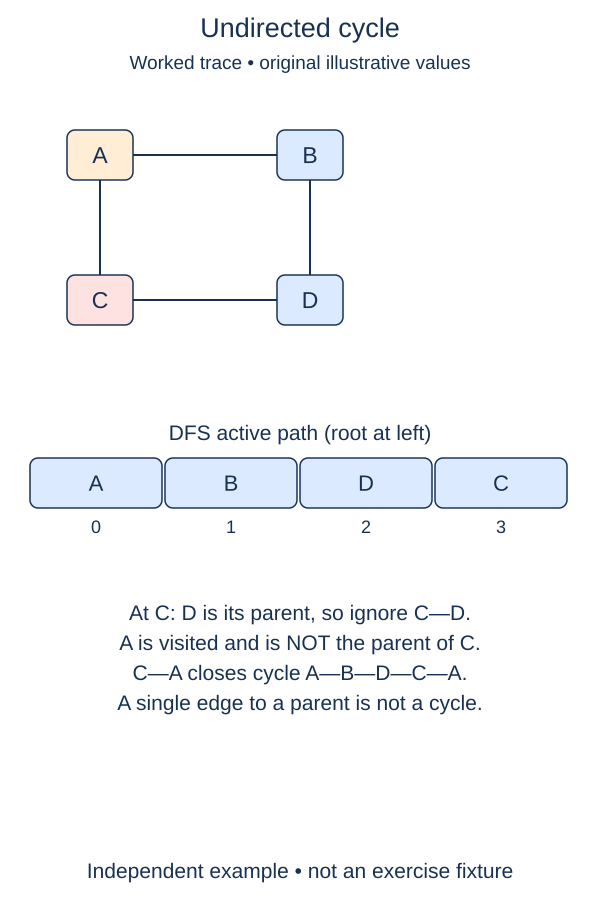

Detect a loop in any component without mistaking an ordinary return edge for a cycle.

An undirected edge appears twice. When a DFS enters south from north, south's list contains north. That entry is the same connection just crossed, so it is not evidence of a cycle. Remember the parent of the current vertex and ignore that one return edge.

A different already-visited neighbor is evidence of another route connecting the vertices. For a triangle, enter the second corner from the first, then the third from the second. At the third corner, the edge back to the first is not the parent edge. It closes a cycle. A two-vertex graph with one link has no such extra edge.

This exercise requires a closed symmetric graph with no repeated entries in a neighbor list. Parallel edges would need edge identities to distinguish the arrival edge from another edge to the same parent; a parent label alone cannot do that. A self-loop is allowed here and counts as a cycle. This analysis contract is broader than the earlier builder, which rejected self-loops.

The recursive visitor is supplied to keep the assessment focused. It marks entry, explores an unseen neighbor, and asks your small predicate about a seen one. Complete the predicate first. Then complete the outer restart loop so a disconnected cyclic component is not overlooked. The empty graph and a forest of trees return `False`.

For example, a path from gate through courtyard to workshop is acyclic. Adding workshop-to-gate changes the answer. An isolated office listed before those vertices must not stop the search. Input and neighbor order remain untouched; order affects the search trace but not the boolean answer.

The full traversal takes expected O(V + E) time and O(V) memory. This visitor is recursive, so use small graphs; the explicit-frame approach from the previous lesson is preferable for potentially deep production inputs. A directed graph needs a different rule, which follows next.

## Worked trace

Simple undirected graph; the edge back to a node's parent alone is not a cycle. In this undirected example, each edge is stored in both directions and B precedes C in A's neighbor list.

## Your Tasks

1. Report a visited neighbor as a back edge only when it is not the parent.
2. Start the supplied cycle search in every unvisited component.

Edit `main.py`. Each numbered comment marks one checkpoint; replace its placeholder without changing the supplied code around it. Run shows the supplied probe, and Submit checks each task separately. You can submit after any step.
