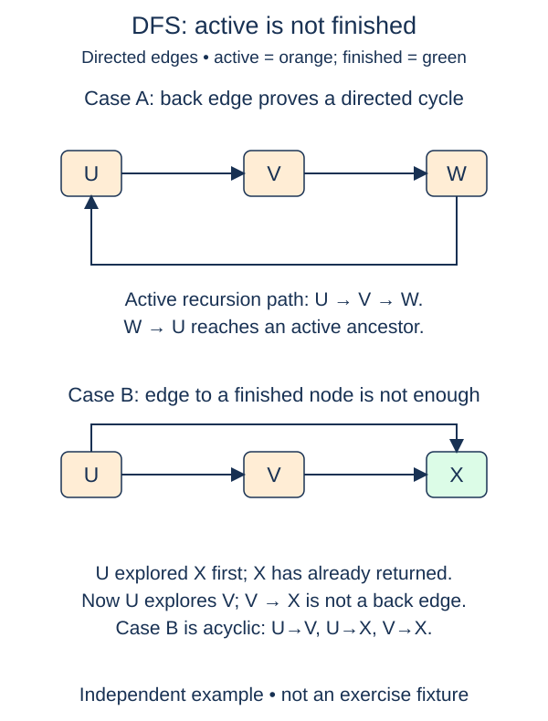

Recognize directed cycles without rejecting two routes that merely meet at a finished station.

For directed edges, a visited set is not enough. Suppose two branches both lead to an archive. The first branch finishes exploring the archive; the second later sees it again. That shared destination does not imply a return path, so it does not prove a cycle.

Use three colors. Zero means not yet discovered. One means active: the vertex's DFS call has begun but has not returned. Two means finished: all outgoing neighbors have been examined. An edge to an active vertex closes a route back to a suspended ancestor. An edge to a finished vertex does not.

The supplied visitor marks each vertex active on entry. Your first checkpoint identifies that color. Your second changes the color to finished just before a successful return. If finishing is omitted, completed calls still look active and an acyclic diamond is incorrectly rejected. The two tests deliberately distinguish that bug from a real cycle.

Unlike the undirected search, this algorithm must not ignore an edge merely because its target is the caller. In a directed graph, outward and return arrows are different edges. A pair of opposite arrows is already a directed cycle. A self-loop is a cycle too. Repeated outgoing entries are harmless because color checks distinguish completed exploration.

For a concrete trace, let plan lead to build and review, and let both build and review lead to publish. After visiting build, publish becomes finished. Review's edge to publish therefore causes no alarm. Adding publish-to-plan instead points to an active ancestor and changes the answer to `True`.

The outer loop is supplied and covers disconnected components in key order. With a closed directed adjacency dictionary, expected time is O(V + E) and storage is O(V), including recursive frames. Keep recursion examples small. The earlier undirected function remains unchanged; choosing the correct graph contract is part of using either routine.

## Worked trace

Active means the recursive call is still waiting to finish. A finished destination may be shared by two acyclic branches.

## Your Tasks

1. Make `is_active` recognize color `1`, but not `0` or `2`.
2. Mark a vertex finished with color `2` after exploring all its outgoing edges.

Edit `main.py`. Each numbered comment marks one checkpoint; replace its placeholder without changing the supplied code around it. Run shows the supplied probe, and Submit checks each task separately. You can submit after any step.
