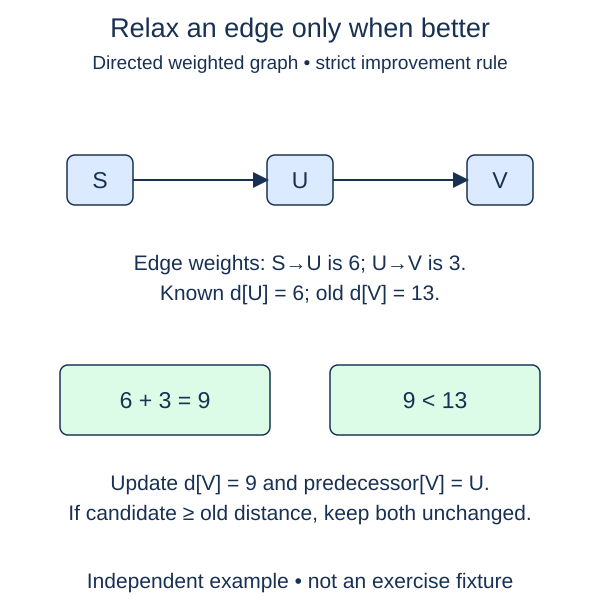

Update a tentative route only when a newly considered edge makes it cheaper.

A tentative distance is the best cost found so far, not necessarily the final answer. If reaching a source costs d and its outgoing edge has weight w, the candidate cost to the target is d + w. Compare that candidate with the target's current distance. A smaller value is an improvement; an equal or larger value changes nothing.

This operation is called relaxation. Suppose the distance to a workshop is 5, a path to a store currently costs 14, and the connecting edge costs 4. The candidate is 9, so the store's distance becomes 9 and its parent becomes the workshop. The parent records which edge justified the new number.

The helper receives existing distance and parent dictionaries and mutates them in place. Both endpoint keys must already be present. Edge validity is a caller precondition here; the surrounding shortest-path functions validate the whole weighted graph once rather than on every relaxation. The three checkpoints separate candidate arithmetic, distance mutation, and parent mutation.

The supplied comparison uses a strict improvement. Do not replace it with an equality-accepting rule. Keeping the first equal-cost route makes ties predictable, and avoids endless rescheduling around a zero-weight cycle. If a source distance is infinity, adding a finite integer weight remains infinity, which cannot improve an unreachable target's infinity.

Return values are already supplied: `True` means an improvement was found, and `False` means no change. The later heap algorithm will use that boolean to decide whether a new queue entry is needed. Do not use a separate visited flag to reject every later improvement; an unsettled vertex can improve several times.

One relaxation uses expected O(1) dictionary operations and O(1) extra space under bounded-cost arithmetic. Python's arbitrarily large integers make arithmetic cost depend on value size, so this is an operation-count model. Infinity is the only float stored in these examples; finite distances remain integer sums.

## Worked trace

Only a strict improvement changes both distance and parent. An equal candidate leaves the existing route intact.

## Your Tasks

1. Compute the candidate distance by adding the current distance and edge weight.
2. Store the candidate when the supplied comparison finds a strict improvement.
3. Record `source` as the improved target's parent.

Edit `main.py`. Each numbered comment marks one checkpoint; replace its placeholder without changing the supplied code around it. Run shows the supplied probe, and Submit checks each task separately. You can submit after any step.
