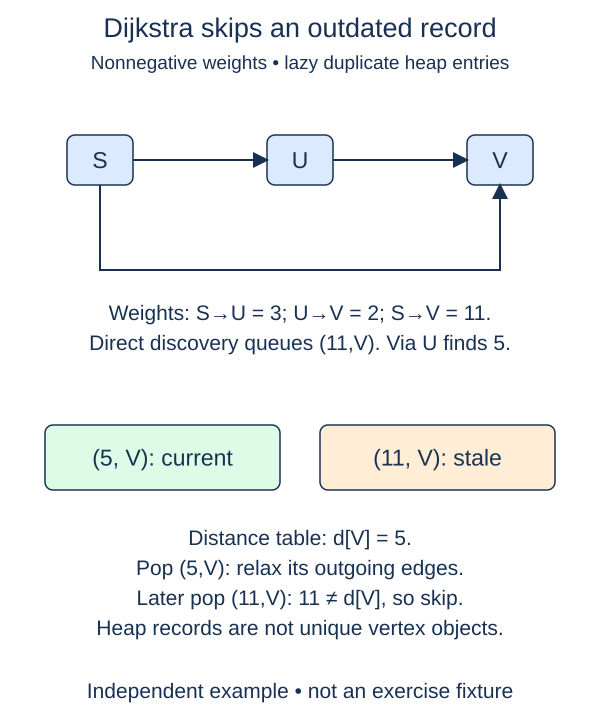

Replace repeated whole-table selection scans with a min-heap of tentative routes.

The completed scan version stays in the file for comparison. This new function uses the same validation, initialization, and relaxation helpers. Its supplied loop removes the heap's minimum entry, skips obsolete work, and scans outgoing edges. You complete the two priority-queue operations: identifying stale entries and scheduling improvements.

A heap entry is `(distance, serial, vertex)`. Tuple ordering compares the distance first. The increasing serial number resolves equal distances by enqueue order, rather than alphabetic vertex labels. `heapq.heappush` inserts an entry while preserving the min-heap invariant; `heappop` removes the smallest. Both operate on an ordinary list, but that list is not globally sorted.

When a distance improves, insert a new entry rather than searching the heap for an older one. Suppose yard was queued at 8 and later improves to 5. Both entries remain. The distance table now says 5, so when the old 8 entry is popped it is stale and must be skipped before reading yard's outgoing list. The older entry does not undo the better route.

Only strict improvements are pushed because the supplied `relax` returns `True` only in that case. This matters for zero-cost cycles: repeatedly enqueueing equal distances would create unending work. A self-loop at zero cost cannot improve its own source and adds nothing to the heap.

The scan version breaks equal-priority selection ties by vertex key order; this version uses enqueue order. Their minimum distances agree, but equal-cost parent choices can differ. Do not assert one universal path when several optimal routes exist. Within each version the stated ordering makes results reproducible.

With lazy entries, the heap can retain O(E) records, not merely V. There are at most O(E) successful improvements. Including validation and initialization, time is O(V + E log(E + 1)) and auxiliary space is O(V + E), under the stated arithmetic and hashing assumptions. This is the bound for this implementation, not an indexed decrease-key heap.

The weighted representation is `dict[str, list[tuple[str, int]]]`: each outgoing entry is `(neighbor, weight)`. Every neighbor must be a key. Labels are strings; weights are nonnegative integers (not booleans). Zero is a real cost. Lists retain insertion order, self-loops are allowed, and each source has at most one entry for a given target. Reverse edges are separate. Supplied validation checks the entire graph, including unreachable components, before a shortest-path search begins.

## Worked trace

The figure abbreviates heap entries to (distance, vertex). The exercise stores (distance, serial, vertex), using the serial number to break equal-distance ties.

## Your Tasks

1. Recognize a stale entry when its queued distance differs from the current distance.
2. Push each improved neighbor with its new distance and supplied serial number.

Edit `main.py`. Each numbered comment marks one checkpoint; replace its placeholder without changing the supplied code around it. Run shows the supplied probe, and Submit checks each task separately. You can submit after any step.
