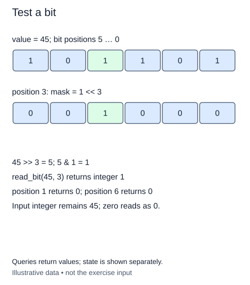

# Read one bit

A collection of on/off switches can fit inside one nonnegative integer. Bit position zero is the rightmost position and has value 1. Position one has value 2; position two has value 4. Each move left doubles the place value. The integer stores the sum of the places that are on.

For a workshop indicator `0b11010`, positions 1, 3, and 4 are on. The `0b` prefix tells Python that the written digits are binary. Leading zeroes are only display padding. They do not reserve storage or impose a width.

## Isolate the position

A right shift moves the position of interest to the units position. It also leaves higher bits above that position, so shifting alone is not enough. Bitwise AND, written `&`, keeps a position only when both operands contain a one there. AND with 1 discards every position except the rightmost one. Return the resulting integer, 0 or 1, rather than the entire shifted value.

Trace position 3 of `11010`: shifting three places leaves `11`; selecting its final position leaves `1`. Position 2 instead leaves `110`, whose final position is `0`. Reading a position beyond the highest one returns zero.

Python integers are arbitrary-size, subject to available memory. Position 80 is legal; there is no automatic 32-bit truncation. This exercise accepts nonnegative integers and positions. The supplied validator rejects negative values with `ValueError` and non-integers with `TypeError`. Keep it in your implementation so a negative shift cannot slip through.

A fixed-width machine model treats a bit operation as constant work. For Python's large integers, shifts and masks can process multiple stored digits. Count the operators separately from the cost of operating on a very large value.

The hints `value: int` and `-> int` describe an integer parameter and integer return value. Hints document the contract; the supplied checks, not the annotations, reject invalid arguments.

## Worked trace



The mask marks the chosen position. read_bit returns an integer 0 or 1, not a boolean, and does not change the input.

## Small example

```python
print(bin(26))
print(26 >> 3)
print(3 & 1)
```

Expected output:

```text
0b11010
3
1
```

## Your Tasks

1. Validate `value` with the supplied nonnegative-integer helper.
2. Validate `position` with the same helper.
3. Return only the selected bit as integer 0 or 1 using bitwise operations.

## Run and check

Edit `main.py`, then press **Run** to inspect the supplied probe. Press **Submit** to check the operation on changed inputs and boundary cases. The probe is supplied. Complete the numbered steps in order; Submit checks each step separately.
