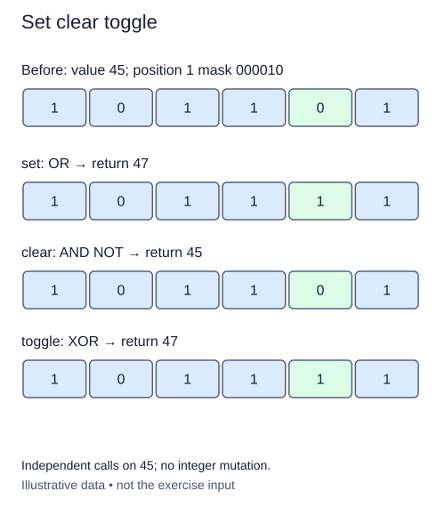

# Set, clear, or toggle a flag

A workshop controller needs to change one indicator without disturbing the others. Keep the value as a nonnegative integer and make a mask containing one set bit. Shifting 1 left by the requested position builds that mask. The position is counted from zero on the right.

## Three meanings for one mask

Bitwise OR (`|`) keeps a one when either operand has one. OR with the mask therefore sets the selected position, even if it was already set. XOR (`^`) keeps a one only when the operands differ. XOR with the mask toggles that position: zero becomes one, and one becomes zero. Applying the same toggle twice restores the original value.

Clearing needs the opposite mask. Python's complement operator follows `~x == -x - 1`; it does not stop after the digits you happen to print. Nevertheless, AND with the complement of a one-bit mask clears exactly that position in a nonnegative integer. The other positions retain their original values. No artificial 32-bit mask is necessary here.

Take `10010` and select position 1, whose mask is `00010`. Setting leaves `10010`; clearing gives `10000`; toggling also gives `10000`. Start instead with `10000`, and toggling produces `10010`. Those two starting states explain why adding the mask is not a substitute for OR: addition can carry into another position.

The function returns a new integer; integers are immutable. Accept only the action strings `set`, `clear`, and `toggle`. Unknown actions raise `ValueError`, as do negative values or positions. The validator supplies the argument checks. A handful of operators is constant in a bounded-word model, but larger Python integers require work proportional to their stored size.

## Worked trace



Independent calls on 45; no integer mutation.

## Small example

```python
print(bin(18 | 2))
print(bin(18 ^ 2))
print(~2)
```

Expected output:

```text
0b10010
0b10000
-3
```

## Supplied setup

Mask construction, action dispatch, and the unknown-action error are supplied. Each branch returns independently; unfinished later branches do not block an earlier branch.

## Your Tasks

1. Reject negative or non-integer values and positions with the supplied helper.
2. In the `set` branch, return the value with the selected bit on.
3. In the `clear` branch, return the value with only the selected bit off.
4. In the `toggle` branch, return the value with the selected bit reversed.

## Run and check

Edit `main.py`, then press **Run** to inspect the supplied probe. Press **Submit** to check the operation on changed inputs and boundary cases. The probe is supplied. Complete the numbered steps in order; Submit checks each step separately.
