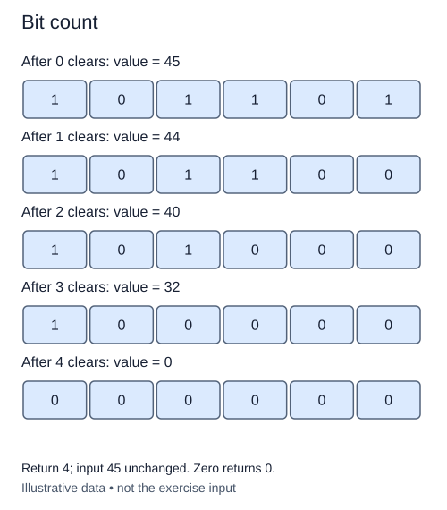

# Count set bits

Counting the number of one bits tells you how many switches are on, regardless of their positions. It is different from measuring the binary length. The value `100000` has six written positions but only one active flag.

## Remove one active bit per step

For a positive integer, subtracting one changes its lowest one to zero and changes all lower zeroes to ones. AND the original value with this smaller value. Higher positions agree, the lowest one disappears, and the lower positions become zero again. The result has exactly one fewer set bit.

For `101100`, the sequence is `101000`, then `100000`, then zero. Three removals mean three set bits. Keep a counter separate from the shrinking working value. The invariant is that the counter plus the number of remaining one bits equals the original answer. Stop when the working value reaches zero, not when its lowest bit is zero.

This exercise asks you to implement a bitwise loop rather than call `int.bit_count`, convert to a binary string, or count characters. Python's built-in is useful in ordinary application code; writing the loop here makes its progress visible. A right-shift loop is also a valid bitwise solution, though it examines zero positions as well.

Zero has no set bits, so its answer is zero without entering the loop. Negative integers are outside this exercise's domain and must raise `ValueError`. Repeated right shifts of a negative integer eventually remain at -1, so a loop that waits for zero could run forever. Validate before starting.

The removal version performs k iterations for k set bits, using a fixed number of integer variables. These variables still occupy space for their bits. With arbitrary-size Python integers, each subtraction and AND has its own digit cost; O(k) describes iterations, not a promise of O(k) machine instructions.

## Worked trace



Return 4; input 45 unchanged. Zero returns 0.

## Small example

```python
value = 44
for _ in range(3):
    value &= value - 1
    print(bin(value))
```

Expected output:

```text
0b101000
0b100000
0b0
```

## Supplied setup

The counter starts at zero and the return statement is supplied. A right-shift bitwise loop is also accepted; do not use string conversion or `bit_count`.

## Your Tasks

1. Reject negative or non-integer input before entering the loop.
2. Replace the loop placeholder with a bitwise loop that counts each set bit once.

## Run and check

Edit `main.py`, then press **Run** to inspect the supplied probe. Press **Submit** to check the operation on changed inputs and boundary cases. The probe is supplied. Complete the numbered steps in order; Submit checks each step separately.
