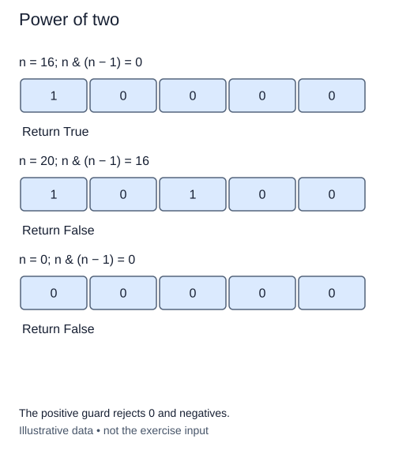

# Recognize a power of two

Some array layouts grow through capacities 1, 2, 4, 8, and so on. Each capacity is a power of two. In binary, these values have exactly one set position. That observation gives you a test without logarithms or floating-point rounding.

The previous lesson removed the lowest set bit. If a positive value has only one set bit, removing it leaves zero. If it has two or more, at least one remains. The expression that removes a bit is therefore useful even when you do not need to count all of them.

## Check the domain before the pattern

Zero requires special care. Removing a lowest bit from zero is not a meaningful description, yet `0 & -1` is zero. A test that only checks the final AND result would incorrectly accept zero. Require a positive value first. Negative integers return `False` in this function; unlike the previous counting exercise, they are valid inputs with a negative answer. Non-integers raise `TypeError`.

Trace three capacities: `1000000` loses its only one, so 64 qualifies. `1001000` leaves `1000000`, so 72 does not. The value 1 also qualifies: it is two to the power zero, and subtracting one leaves zero. Do not accidentally require the value to be greater than 1.

Python does not impose a largest power at bit 31 or 63. A value with a single bit at position 150 must still qualify. Converting it to a float or taking a floating logarithm would introduce precision and range problems that the integer test avoids.

Use a boolean return so the caller can place the result directly in a condition. Under a bounded-integer model this uses constant work and a fixed number of temporary values. For large Python integers, the subtraction and bitwise comparison must inspect stored digits.

## Worked trace



The positive guard rejects 0 and negatives.

## Small example

```python
print(64 & 63)
print(72 & 71)
print(0 & -1)
```

Expected output:

```text
0
64
0
```

## Your Tasks

1. Raise `TypeError` when the input is not an integer.
2. Use bitwise operations to return a boolean that accepts exactly positive one-bit values, including 1.

## Run and check

Edit `main.py`, then press **Run** to inspect the supplied probe. Press **Submit** to check the operation on changed inputs and boundary cases. The probe is supplied. Complete the numbered steps in order; Submit checks each step separately.
