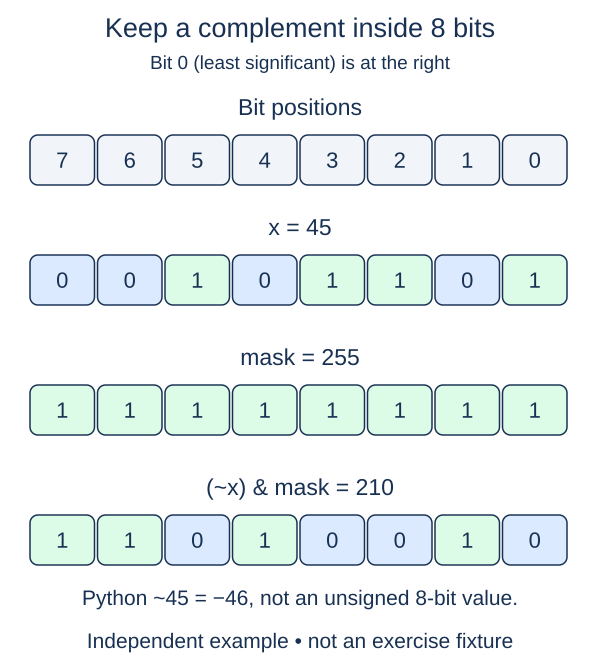

# Choose a fixed-width mask

A device packet may reserve exactly five bits for an indicator field. Python integers do not adopt that width automatically. You must explicitly decide which positions belong to the field and discard all others.

A width of w covers positions zero through w-1. The mask `(1 << w) - 1` contains ones in those positions. AND with that mask keeps the low w bits of any integer. The result is always between zero and the mask, inclusive. For a negative integer this chooses its residue modulo two to the power w; it does not turn the input into a signed fixed-width Python type.

## Complement within a boundary

Plain complement is not a finite-width inversion. Python defines `~x` as `-x - 1`. For example, `~9` is -10, not a positive pattern whose width Python inferred from the printed digits. To obtain a finite field, complement and then mask, or normalize to the field and XOR with the all-ones mask.

With width five, 9 is displayed as `01001`. Its finite complement is `10110`, or 22. With width three, the same input first contributes only `001`, whose complement is `110`, or 6. The width changes the question, not just the formatting.

Our contract accepts any integer value, including negatives and values wider than the field. Width must be a nonnegative integer; boolean values are rejected rather than treated as widths zero or one. Width zero represents an empty field and returns zero. Negative width raises `ValueError`; non-integer arguments raise `TypeError`. There is no arbitrary upper cap such as 32.

The function returns a new nonnegative integer and does not preserve a separate display width. You can use formatting when you want leading zeroes on screen. Building and applying the mask requires space and work for its digits, so a very large width is not a constant-cost operation.

## Worked trace



Here the width is eight: the mask keeps only positions 0 through 7. The negative value from plain complement is not the final field value.

## Small example

```python
print(~9)
print((~9) & 31)
print((~9) & 7)
```

Expected output:

```text
-10
22
6
```

## Supplied setup

The all-ones mask expression is supplied so the final step is just complementing and restricting the result.

## Your Tasks

1. Reject non-integer `value`; negative integers remain valid.
2. Validate `width` as a nonnegative integer with the supplied helper.
3. Return the complemented low-width field using the supplied mask.

## Run and check

Edit `main.py`, then press **Run** to inspect the supplied probe. Press **Submit** to check the operation on changed inputs and boundary cases. The probe is supplied. Complete the numbered steps in order; Submit checks each step separately.
