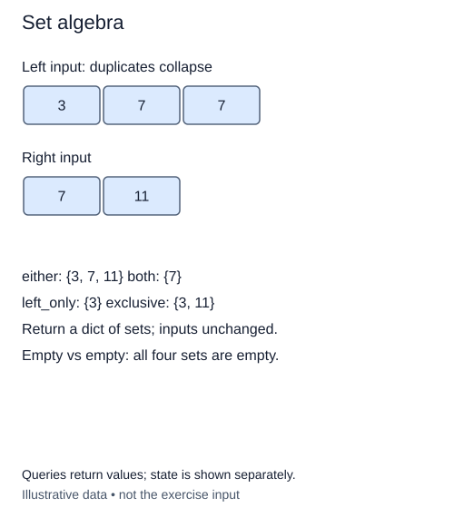

# Compare groups with set algebra

Two volunteer teams keep separate sign-up lists. A name can appear more than once in a list, but group membership should count it only once. Python's `set` represents this distinct-membership view. This lesson uses the built-in set rather than implementing a hash table.

Converting an iterable to a set removes duplicate members. Its elements must be hashable: strings and integers work; ordinary lists do not. A set has no promised display order, so compare set values directly rather than relying on how their members print.

## Four useful comparisons

Union includes anyone in either group. Intersection includes only people in both. Difference is directional: left minus right includes members of the left group who are absent from the right. Symmetric difference includes people in exactly one group. Shared members are excluded from that last result. For sets `a` and `b`, write these operations as `a | b`, `a & b`, `a - b`, and `a ^ b`, respectively. Unlike the integer operators from earlier lessons, these operators now compare collection membership.

For rehearsal groups `{Ada, Bo}` and `{Bo, Cy}`, the union has all three names, the intersection has Bo, the left-only group has Ada, and the exclusive group has Ada and Cy. Notice that left-only and exclusive answer different questions. Reversing the inputs changes left-only but not the other three results.

Return a dictionary with keys `either`, `both`, `left_only`, and `exclusive`, whose values are new sets. Make local sets from the supplied iterables first. This avoids altering a caller's set and also lets callers pass lists or tuples. Do not use mutating operations on the original arguments. Returning the original left set for an empty-right case would create an unwanted alias.

Empty groups require no special mathematical exception: their union is the other group, and their intersection is empty. Duplicate inputs must not create duplicate output members. Assuming ordinary well-distributed hashes and bounded-cost keys, converting and combining groups takes expected O(a+b) work and O(a+b) result space. Hash collisions or expensive key operations can increase that cost.

The imported hint `Iterable` means an input you can loop over, and `Hashable` describes members usable in a set or dictionary key. Square brackets state the contained type. These hints allow strings or integers without pretending that mutable lists can be set members.

## Worked trace



Queries return values; state is shown separately.

## Small example

```python
a = {"Ada", "Bo"}
b = {"Bo", "Cy"}
print(sorted(a & b))
print(sorted(a ^ b))
```

Expected output:

```text
['Bo']
['Ada', 'Cy']
```

## Supplied setup

Input conversion and the four-key return dictionary are supplied. Replace one `None` result at a time; each check reads only its named entry.

## Your Tasks

1. Fill `either` with the union of the two local sets.
2. Fill `both` with their intersection.
3. Fill `left_only` with members of the left set absent from the right.
4. Fill `exclusive` with members present in exactly one set.

## Run and check

Edit `main.py`, then press **Run** to inspect the supplied probe. Press **Submit** to check the operation on changed inputs and boundary cases. The probe is supplied. Complete the numbered steps in order; Submit checks each step separately.
