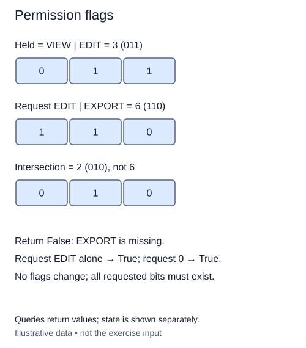

# Check a permission bundle

A workshop account can have several permissions at once. Assign each permission a different single-bit mask. The supplied constants use positions zero, one, and two for viewing, editing, and exporting. OR combines permissions into one held value.

The operation in this lesson answers a single question: does the held value contain every requested bit? It does not grant or remove permissions. Keep that distinction clear because a permission check should not change the account it inspects.

## All is different from any

AND the held mask with the requested mask to retain only requested bits the account actually has. Compare that result to the complete requested mask. Equality means none of the requested positions were lost. Testing only whether the AND result is nonzero would answer whether any requested permission is present, which is weaker.

For a separate illustration, suppose access areas use positions 3 and 5. An account holding only position 3 overlaps the two-area request but must fail the all-areas check. An account holding both positions passes, even if it also holds unrelated positions. Extra permissions are harmless to this question.

The empty request, zero, is always satisfied. It asks for nothing, so even an account with no permissions passes. A held mask of zero fails any nonempty request. Both masks must be nonnegative integers; the supplied helper defines rejection of negatives and non-integers. Unknown high positions are allowed and behave like any other requested flag. This keeps the operation useful beyond the three sample constants.

Return an actual boolean. Do not compare the held mask directly to the request, because that would reject an account with additional permissions. The bitwise work is constant for bounded-size values; arbitrary-size values have a cost related to their stored digits. This completes a small practical use of masks while retaining the same nonnegative domain used in earlier flag operations.

## Worked trace



Queries return values; state is shown separately.

## Small example

```python
held = 1 << 3
requested = (1 << 3) | (1 << 5)
print(bool(held & requested))
print((held & requested) == requested)
```

Expected output:

```text
True
False
```

## Your Tasks

1. Validate both masks as nonnegative integers.
2. Return whether the intersection contains every requested bit, including an empty request.

## Run and check

Edit `main.py`, then press **Run** to inspect the supplied probe. Press **Submit** to check the operation on changed inputs and boundary cases. The probe is supplied. Complete the numbered steps in order; Submit checks each step separately.
