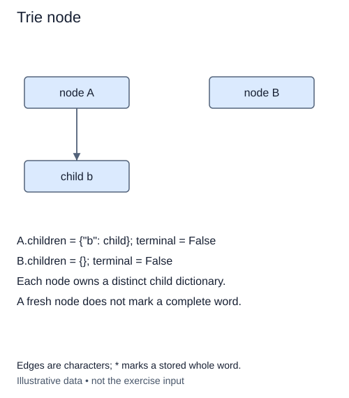

# Give each trie node its own children

Sets answered whether a whole value was present. A word index can also share its early characters instead of storing every word as an unrelated key. A trie is a tree whose edges are labeled with characters. The path from the root spells a prefix. Words such as `map` and `mat` share the edges for `m` and `a`, then split.

A node does not need to store the whole prefix. Its position in the tree already identifies that prefix. Store a `children` dictionary mapping one-character strings to child nodes. Store a separate boolean `terminal` telling you whether a complete word ends at this node.

## A path is not necessarily a word

After storing only `maps`, the path for `map` exists but its node is not terminal. After also storing `map`, that same node becomes terminal while keeping its child for `s`. A node can therefore mark a complete word and have children at the same time. Treating every leaf as a word would miss this distinction.

The root represents the empty prefix. Later, inserting the empty string will mark the root itself terminal without adding an edge. We will use set semantics throughout this module: inserting the same word again does not create another occurrence, and deleting it once removes it. Words are case-sensitive strings; characters are used exactly as supplied, without normalization.

Create a fresh dictionary in each constructor call. A class-level dictionary would accidentally connect unrelated nodes and even unrelated tries. The first task is only this node state, not insertion or traversal. The probe changes one node and shows that a second node stays empty.

The annotation `dict[str, TrieNode]` describes string keys and node values. The future-annotations import lets the class refer to its own name before its definition is complete. An empty node needs constant initial state; a node with d outgoing characters later stores O(d) references. Across the trie, storage follows the number of distinct prefix nodes, not merely the number of words.

## Worked trace



Edges are characters; * marks a stored whole word.

## Small example

```python
paths = {"map": False, "maps": True}
print(paths["map"])
paths["map"] = True
print(paths["map"], paths["maps"])
```

Expected output:

```text
False
True True
```

## Supplied setup

The two attributes have temporary `None` placeholders. The first check never reads `terminal`, and the second check never reads `children`.

## Your Tasks

1. Give each node its own empty `children` dictionary.
2. Set each new node's `terminal` marker to `False`.

## Run and check

Edit `main.py`, then press **Run** to inspect the supplied probe. Press **Submit** to check the operation on changed inputs and boundary cases. The probe is supplied. Complete the numbered steps in order; Submit checks each step separately.
