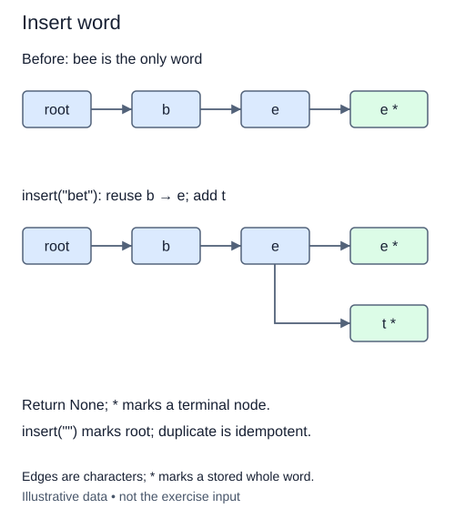

# Insert a word by sharing its prefix

The node representation is complete. The supplied `Trie` constructor now creates one root node for each index. Your insertion method starts at that root and follows the word one character at a time.

At every step, check whether the current node already has an edge for the next character. If it does, reuse that child. If not, create a new node and attach it under that character. Move to the child before processing the next character. After the final character, mark the current node terminal.

## Preserve the shared path

Imagine inserting `sun`, then `sum`. The second insertion reuses the root's `s` child and that child's `u` child. Only the `m` child is new. Replacing an existing child with a fresh node would lose words stored beneath it. Marking every visited node terminal would invent words such as `s` that were never inserted.

The loop invariant is that the current node represents exactly the characters already consumed. At the end it represents the entire word, which is why only that node receives the terminal marker. Inserting a shorter word after a longer one may need no new nodes, only a changed marker.

Insertion returns `None`. Duplicate insertion is idempotent: it leaves the same word present once and retains existing nodes. Inserting an empty string performs zero character steps and marks the root. Strings are case-sensitive and may contain any characters. The supplied class is a continuation of the previous node lesson; do not rebuild completed node behavior.

The annotation `word: str` documents the string contract, and `-> None` means the method changes the trie rather than returning a result. Type hints do not perform runtime validation. For a word of length L, insertion takes expected O(L) dictionary operations and allocates at most L nodes, assuming ordinary character hashing. Very long words consume storage even when the method itself uses only one moving node reference.

## Worked trace



Edges are characters; * marks a stored whole word.

## Small example

```python
existing = {"s": {"u": {"n": True}}}
existing["s"]["u"]["m"] = True
print(sorted(existing["s"]["u"]))
```

Expected output:

```text
['m', 'n']
```

## Supplied setup

The initial `node = self.root` is supplied. First build the path; the first check does not require any terminal markers.

## Your Tasks

1. Walk the characters, reusing existing children and allocating only missing nodes.
2. Mark only the node reached after the last character as terminal.

## Run and check

Edit `main.py`, then press **Run** to inspect the supplied probe. Press **Submit** to check the operation on changed inputs and boundary cases. The probe is supplied. Complete the numbered steps in order; Submit checks each step separately.
