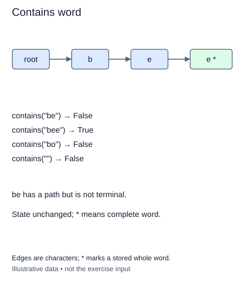

# Search for a complete word

Insertion made character paths. A membership query must now decide whether one of those paths is a stored whole word. Keep the completed insertion method; this stage adds only `contains`.

Start from the root and inspect each character in order. A missing child makes the answer false immediately. Do not create the missing child during a search. If every character has a matching edge, the path exists, but the answer still depends on the final node's terminal marker.

## The final marker decides

If the index contains `harbor`, searching for `har` can follow three edges successfully. It must still return false because only `harbor` was inserted. Searching for `harbors` fails at the extra `s` edge. Searching for `harbor` reaches the terminal node and returns true.

This separation keeps shorter and longer words independent. Insert `har` later and its existing node becomes terminal without altering `harbor`. A read-only query never changes either marker. Tests inspect the children before and after missing lookups because a query that accidentally creates nodes can appear to return the right boolean while damaging the representation.

The empty word takes no steps and reads the root's terminal marker. A fresh trie therefore does not contain it, even though the empty prefix always has a path. It becomes a stored word only after insertion. The duplicate policy remains set membership, and spelling remains case-sensitive.

Return a boolean rather than a node or the original query string. The annotation `-> bool` records that caller-facing promise. For length L, the search uses at most L expected dictionary lookups and one terminal check, with constant auxiliary references. It may stop early on a missing edge. The amount of work depends on query length rather than the total number of stored words.

## Worked trace



Edges are characters; * marks a stored whole word.

## Small example

```python
stored = {"harbor"}
print("har" in stored)
print(any(word.startswith("har") for word in stored))
```

Expected output:

```text
False
True
```

## Supplied setup

The root cursor is supplied. Missing-path checks do not require the successful-path return, so you can finish the walk before the final return.

## Your Tasks

1. Follow the character path and return `False` at the first missing edge.
2. After a complete walk, return the final terminal marker.

## Run and check

Edit `main.py`, then press **Run** to inspect the supplied probe. Press **Submit** to check the operation on changed inputs and boundary cases. The probe is supplied. Complete the numbered steps in order; Submit checks each step separately.
