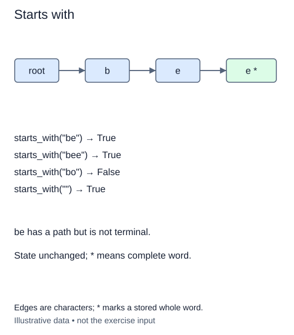

# Search for a prefix path

Autocomplete begins with a different question from whole-word search: can these characters lead into the index? A prefix query follows the same character edges as `contains`, but successful traversal is enough. It does not require the last node to be terminal.

With `cabin` stored, both `ca` and `cabin` are existing prefix paths. `cabins` is not. A caller can use this inexpensive check before asking for actual completions. The completed `contains` method remains unchanged so the two questions stay separate.

## Name the empty-prefix rule

This module defines `starts_with` as path existence. The root is always present, so the empty prefix returns true even for an empty trie. This does not say the empty string is a stored word, nor does it promise any completion exists. Later, a prefix count of zero will answer the latter question directly.

Walk from the root without allocating anything. Return false as soon as the next edge is missing. If the loop finishes, return true. This structure makes a zero-character query work naturally: it completes the loop without taking an edge.

A common error is to call `contains(prefix)` and return that result. That rejects prefixes such as `ca` which are not complete words. Another error is to look only at the first character; `c` may exist while `cz` does not. Each successful step establishes that the consumed prefix matches the current node, and the next step must continue from that node rather than restarting at the root.

A prefix of length P takes at most P expected dictionary lookups and constant extra references. The method returns a boolean and leaves the trie untouched. It does not traverse all descendant words, so it can be much cheaper than collecting suggestions for a popular short prefix.

## Worked trace



Edges are characters; * marks a stored whole word.

## Small example

```python
word = "cabin"
print(word.startswith("ca"))
print(word.startswith("cabins"))
print(word.startswith(""))
```

Expected output:

```text
True
False
True
```

## Supplied setup

The root cursor is supplied. Missing-path checks do not require the successful-path return, so you can finish the walk before the final return.

## Your Tasks

1. Follow the character path and return `False` at the first missing edge.
2. After a complete walk, return `True`, including for the empty prefix.

## Run and check

Edit `main.py`, then press **Run** to inspect the supplied probe. Press **Submit** to check the operation on changed inputs and boundary cases. The probe is supplied. Complete the numbered steps in order; Submit checks each step separately.
