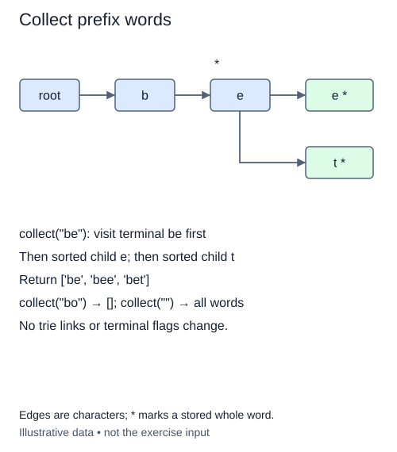

# Collect the words below a prefix

A prefix test tells you whether a path exists. To show suggestions, you must visit the word endings below that path. This stage adds `collect(prefix)` and keeps the earlier node, insertion, and query methods intact.

First follow the prefix from the root. If an edge is missing, return an empty list. Otherwise, you have found the subtree that matters. There is no reason to scan unrelated root branches.

## Carry the spelling during traversal

Traverse this subtree depth first while carrying the spelling of the current path. Whenever a node is terminal, append that spelling to a new result list. Then visit its children. A terminal node may have children, so finding a word must not stop traversal.

For words `ink`, `inlet`, and `inn`, collecting `in` reaches the shared node and then visits the `k`, `l`, and `n` branches. The result is `['ink', 'inlet', 'inn']`. If `in` itself is inserted, it appears before its extensions. Visit child characters in Python's sorted string order to make the result deterministic. This is lexicographic ordering, not locale-aware dictionary ordering or case folding.

A nested helper can hold the recursive traversal. Its `node: TrieNode` and `word: str` arguments name the current position and spelling; its `-> None` result means it appends to the enclosing list. A new result list on every call prevents callers from damaging future answers by editing an earlier result.

Empty prefix collects the whole trie. Empty word appears as `''` if the root is terminal. Duplicate insertions produce one output word because the terminal marker is boolean. The traversal visits the matching subtree's nodes, sorts each node's outgoing characters, and constructs output strings. Account for those sorting and string-copy costs, not just the number of returned words. Recursion also uses one frame per path depth; keep teaching examples small rather than increasing recursion limits.

## Worked trace



Edges are characters; * marks a stored whole word.

## Small example

```python
words = ["inn", "ink", "inlet"]
print(sorted(words))
print("in" < "ink")
```

Expected output:

```text
['ink', 'inlet', 'inn']
True
```

## Supplied setup

The result list, nested-helper signature, call to `visit`, and return are supplied. Step 1 is assessed only with missing prefixes. Step 2 checks a word ending at the located prefix, before you descend into child branches.

## Your Tasks

1. Follow the prefix and return an empty list if its path is missing.
2. In `visit`, append the current spelling if this node is terminal.
3. In `visit`, recurse through child edges in sorted character order.

## Run and check

Edit `main.py`, then press **Run** to inspect the supplied probe. Press **Submit** to check the operation on changed inputs and boundary cases. The probe is supplied. Complete the numbered steps in order; Submit checks each step separately.
