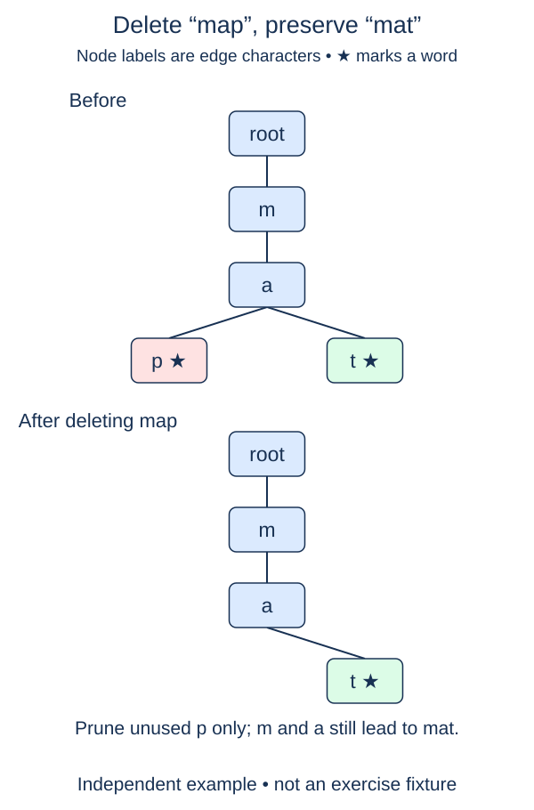

# Delete a word without deleting its neighbors

Deletion is more delicate than insertion because several words may share the path you walked. Removing a root branch wholesale can delete neighbors the caller never asked to remove. Keep the completed methods and add a deletion that changes only one word's membership.

Walk the requested word while recording each `(parent, character)` edge in a trail. A missing edge means the word is absent. If traversal reaches a nonterminal node, the path exists only as a prefix, so the word is also absent. Return false in either case without changing the trie.

## Unmark first, then prune backward

When the final node is terminal, clear its marker. You have removed the word logically. Now walk the recorded trail backward and consider removing unused edges. A child can be detached only when it has no children and is not terminal. Stop pruning as soon as either condition fails.

Consider `ram`, `ramp`, and `rat`. Deleting `ram` clears its marker but retains its `p` child, so `ramp` survives. Deleting `ramp` next removes its unused suffix; the `ra` path still leads to `rat`, so pruning stops there. Deleting `ra` would do nothing because it was never a word.

Return true only when a stored word was removed. Duplicate insertions have set semantics, so one deletion removes that word and a repeated deletion returns false. Deleting the empty word clears the root marker but never deletes the root or its children. A fresh trie remains independently empty.

The trail stores O(L) parent references for a word of length L. Walking and pruning take expected O(L) dictionary work. Retaining the trail avoids searching for parents again and gives you the exact character key to remove. The returned boolean reports membership change, not the number of nodes pruned.

## Worked trace



The star marks a complete word. Clear the marker for map, then detach only its unused p node; the shared path still belongs to mat.

## Small example

```python
endings = {"ram": True, "ramp": True, "rat": True}
endings["ram"] = False
print([word for word, terminal in endings.items() if terminal])
```

Expected output:

```text
['ramp', 'rat']
```

## Supplied setup

The root cursor, empty trail, and successful `True` return are supplied. Step 2 checks word membership without requiring dead-node pruning; step 3 checks the remaining structure.

## Your Tasks

1. Follow the word while saving its edges; return `False` for a missing path or nonterminal endpoint.
2. Clear the matched node's terminal flag without changing its children.
3. Walk the saved edges backward and detach only childless, nonterminal nodes; stop at the first needed node.

## Run and check

Edit `main.py`, then press **Run** to inspect the supplied probe. Press **Submit** to check the operation on changed inputs and boundary cases. The probe is supplied. Complete the numbered steps in order; Submit checks each step separately.
