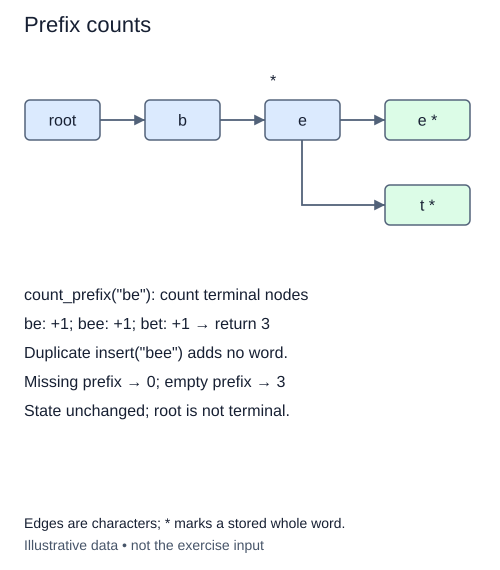

# Count words sharing a prefix

The suggestion panel may need a total before displaying a limited list. Counting words is not the same as counting nodes: many nodes represent unfinished prefixes, while a terminal node with children still counts as one word.

This stage keeps the existing node representation and computes counts when asked. It does not introduce cached counters into insertion and deletion. That choice preserves their contracts and avoids a second mutable invariant. A later design could cache subtree totals, but it would need to update every affected ancestor on each membership change.

## Count markers, not edges

Follow the prefix exactly as in collection. A missing path returns zero. From a matching node, traverse its subtree using an explicit stack of nodes. Count one for every terminal marker you encounter. Push child nodes regardless of whether the current node is terminal.

For `tea`, `team`, and `ten`, the prefix `te` has three matching words. The node for `tea` counts once and still leads to `team`. Inserting `tea` again does not change the total. Deleting `tea` leaves two matches, including `team`. Counting leaves alone would miss the shorter stored word before deletion.

No spelling strings need to be constructed, and child order does not matter when the result is only a number. The stack is a local list, so consecutive calls and independent tries cannot share pending nodes. The annotation `list[TrieNode]` describes a list of node references, not a list of words.

Empty prefix counts all distinct stored words, including the empty word if present. On an empty trie the answer is zero, even though `starts_with('')` is true. This is the promised distinction between path existence and actual completions.

For prefix length P and S nodes in its matching subtree, counting takes expected O(P+S) work and up to O(S) stack references. It avoids collection's sorting and output-string construction, but it is not an O(P) cached-count query.

## Worked trace



The three stars represent be, bee, and bet. Count them during this query; the node class has no cached count field.

## Small example

```python
markers = [False, True, True, False, True]
print(sum(markers))
```

Expected output:

```text
3
```

## Supplied setup

Stack initialization, a zero counter, a bounded `while stack` loop, and its return are supplied. Missing-path checks finish before the counting loop. Counting the starting node can earn a check before visiting its descendants.

## Your Tasks

1. Follow the prefix and return zero when its path is missing.
2. Count one for a terminal node popped from the stack, and zero otherwise.
3. Add the popped node's children to the stack so every descendant is visited.

## Run and check

Edit `main.py`, then press **Run** to inspect the supplied probe. Press **Submit** to check the operation on changed inputs and boundary cases. The probe is supplied. Complete the numbered steps in order; Submit checks each step separately.
