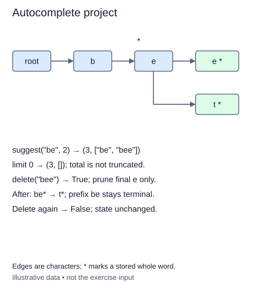

# Build a bounded autocomplete result

The trie now supports membership, prefix lookup, collection, deletion, and counting. Use those completed operations to make the result a small autocomplete panel needs. This final stage adds one reporting method rather than rewriting the data structure.

Return a pair `(total, suggestions)`. The total counts every distinct stored word with the requested prefix. Suggestions contain at most `limit` words in the same lexicographic order used by `collect`. Limiting the displayed list must not limit the total.

## Keep display size separate from matching size

If `br` matches `branch`, `brass`, and `brick`, a limit of two returns total three with the first two words. A limit of zero returns the same total and an empty list. A missing prefix returns zero and an empty list. These cases make it possible for a caller to show a count without displaying entries yet.

The limit must be a nonnegative integer. Reject negatives with `ValueError` and non-integers with `TypeError`. Do not rely on Python's negative slicing behavior: a negative limit would silently mean something quite different from a display cap. Validation belongs before the report is assembled.

The annotation `tuple[int, list[str]]` means a two-item tuple whose first item is an integer and second item is a list of strings. It does not mean a list of two suggestions. The list must be fresh, so changing the returned suggestions cannot alter stored words or the next report.

This version deliberately composes `count_prefix` and `collect`, then slices the ordered result. It is easy to inspect and preserves the earlier methods. It also visits the matching subtree twice and creates the full collection before limiting it. A small limit therefore does not make this implementation a small-work query. A future traversal could stop after enough suggestions while using cached totals, but those are different invariants, not hidden requirements here.

After deleting or inserting a word, the next report must reflect the new membership. No report cache is supplied.

## Worked trace



Edges are characters; * marks a stored whole word.

## Small example

```python
matches = ["branch", "brass", "brick"]
print((len(matches), matches[:2]))
```

Expected output:

```text
(3, ['branch', 'brass'])
```

## Supplied setup

The two-item return tuple is supplied with independent `None` slots. The count check ignores the suggestion-list slot.

## Your Tasks

1. Reject non-integer limits with `TypeError`.
2. Reject negative integer limits with `ValueError`.
3. Fill the tuple's first item with the full matching word count, regardless of the limit.
4. Fill the second item with a fresh sorted completion list cut to the limit.

## Run and check

Edit `main.py`, then press **Run** to inspect the supplied probe. Press **Submit** to check the operation on changed inputs and boundary cases. The probe is supplied. Complete the numbered steps in order; Submit checks each step separately.
