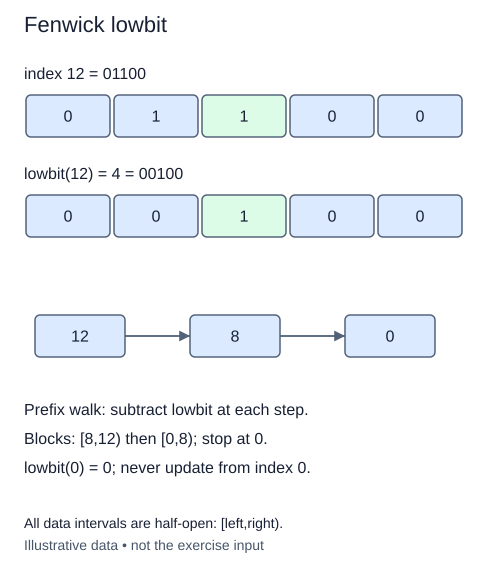

# Find the lowest set bit

The trie grouped words by shared prefixes. We now turn to numeric sequences, where a prefix means the values before an index boundary. A Fenwick tree stores carefully chosen partial sums so an update or prefix query can skip groups of values. The group size at an internal index comes from its lowest set bit, often called `lowbit`. Before building the tree, isolate and inspect that quantity.

For a positive integer i, `i & -i` keeps only its rightmost one bit. The result is a power of two. Python's integer semantics make this work without a fixed 32-bit width. Our helper also defines `lowbit(0)` as zero, but rejects negative integers and non-integers with the supplied validator.

## Read a block from its ending boundary

A Fenwick cell at internal index i will cover public positions in the half-open interval `[i - lowbit(i), i)`. Half-open means include the left boundary and exclude the right. At i=12, binary `1100`, lowbit is 4, so the cell covers public positions 8, 9, 10, and 11. At i=10, binary `1010`, lowbit is 2 and the cell covers positions 8 and 9.

Subtracting lowbit from a positive index removes one set bit and moves to a smaller prefix boundary. The boundaries for a prefix ending at 13 are 13, 12, 8, then 0. Their blocks are adjacent and do not overlap. Adding lowbit instead moves upward to the next containing block; we will use that direction for updates.

Zero is a stopping boundary, not a usable update cell. Since `lowbit(0)` is zero, adding it to zero makes no progress. Never start an update loop at internal index zero. Later lessons convert public item index p to internal index p+1 before stepping.

This task implements only the helper. Its annotation `-> int` means the returned step is an integer, not a boolean indicating whether a bit exists. The operation is constant work for bounded-width indices; arbitrary-size integer operations process stored digits.

## Worked trace



All data intervals are half-open: [left,right).

## Small example

```python
for index in [13, 12, 8]:
    step = index & -index
    print(index - step, index)
```

Expected output:

```text
12 13
8 12
0 8
```

## Your Tasks

1. Validate `index` as a nonnegative integer.
2. Return the isolated lowest set bit, or zero for index zero.

## Run and check

Edit `main.py`, then press **Run** to inspect the supplied probe. Press **Submit** to check the operation on changed inputs and boundary cases. The probe is supplied. Complete the numbered steps in order; Submit checks each step separately.
