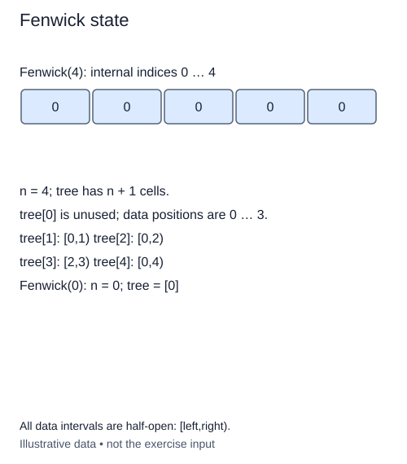

# Allocate one-based Fenwick storage

A public sequence of n values has item indices zero through n-1. A Fenwick tree uses internal cells one through n. Both conventions belong to the same structure, so write the conversion down before implementing any loop.

The class stores `n`, the number of public items, and `tree`, a list of n+1 partial sums. Cell zero is reserved and remains zero. Public item p first contributes to internal cell p+1. The extra slot is therefore intentional, not an off-by-one allocation error.

## Begin with a zero sequence

The constructor in this stage receives a size, not initial values. Every public item begins at zero, so every partial sum is also zero. Allocate the list and record the size. Do not add a constructor loop that calls future methods; the update method has not been written yet.

For size five, the list has six cells. Internal cell 1 describes public `[0, 1)`, cell 2 describes `[0, 2)`, cell 3 describes `[2, 3)`, cell 4 describes `[0, 4)`, and cell 5 describes `[4, 5)`. The intervals come from `[i-lowbit(i), i)` rather than from treating each cell as one original value.

A size of zero is valid and still allocates the reserved cell. It represents an empty public sequence. Negative sizes raise `ValueError`; non-integer sizes raise `TypeError`. The supplied helper handles this validation. Every instance needs its own list so updating one tree later cannot affect another.

The annotation `tree: list[int]` describes integer partial sums. It does not turn the list into a special array type. Multiplying `[0]` to allocate slots is safe here because integer zero is immutable; later assigning a cell replaces a reference rather than mutating a shared number.

Allocation takes O(n) time and O(n) storage, with a one-cell minimum for an empty structure. The completed `lowbit` helper stays available. This lesson adds only state; later stages will establish how values move through it.

## Worked trace



All data intervals are half-open: [left,right).

## Small example

```python
for index in range(1, 6):
    print(index, (index - (index & -index), index))
```

Expected output:

```text
1 (0, 1)
2 (0, 2)
3 (2, 3)
4 (0, 4)
5 (4, 5)
```

## Your Tasks

1. Validate the requested size with the nonnegative-integer helper.
2. Set `n` to the requested public size.
3. Allocate a fresh zero-filled list of `size + 1` cells for `tree`.

## Run and check

Edit `main.py`, then press **Run** to inspect the supplied probe. Press **Submit** to check the operation on changed inputs and boundary cases. The probe is supplied. Complete the numbered steps in order; Submit checks each step separately.
