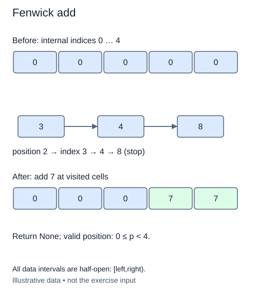

# Propagate a Fenwick point addition

The zero-filled Fenwick state is ready. Add a delta to one public item and update every stored block that includes that item. This operation is an addition, not an assignment: adding -3 reduces the current item by three, and adding zero leaves it unchanged.

Validate the public index before touching storage. Valid positions satisfy `0 <= position < n`; otherwise raise `IndexError`. A non-integer position or delta raises `TypeError`. For an empty tree there are no valid point positions.

## Cross the indexing boundary once

Set the internal cursor to public position plus one. From there, add the delta to the current cell and move the cursor upward by its lowbit. Continue while the internal cursor is at most n. Cell n is a valid cell, so a strict less-than bound would miss a necessary update at the end.

For size eight and public position four, the internal path is 5, 6, 8. Those cells cover `[4,5)`, `[4,6)`, and `[0,8)`. All contain public position four. Cell zero stays untouched. Starting from public position zero without the conversion would repeatedly add `lowbit(0)`, which is zero, and never terminate.

After each step, the visited cells include the delta. The remaining containing cells still need repair; cells outside the update path keep their correct old sums. The update path identifies exactly the summaries that need repair; it is not a scan over every later item. The loop invariant is that all containing cells below the current internal cursor have already received the delta.

Return `None` after mutation. Earlier constructor and lowbit code are supplied unchanged. Under bounded-cost integer arithmetic, the update visits O(log(n+1)) cells and uses O(1) additional references. Large integer sums have extra arithmetic cost. There is still no array of original values in this class: the tree stores only partial sums.

## Worked trace



For four public items, update position 2 at internal cells 3 and 4. Cursor 8 is the stopping boundary, not an allocated cell to write.

## Small example

```python
index = 5
while index <= 8:
    print(index)
    index += index & -index
```

Expected output:

```text
5
6
8
```

## Supplied setup

Replace the temporary early `return None` with your validation before working on the cell change. The conversion `position + 1`, loop bound, and increasing lowbit step are supplied. Keep them unchanged. Rejecting negative positions before the loop is essential: position -1 would otherwise start at internal index zero and never advance.

## Your Tasks

1. Reject invalid types or a public position outside `0 <= position < n` before mutation.
2. Inside the supplied lowbit loop, add `delta` to the current internal cell.

## Run and check

Edit `main.py`, then press **Run** to inspect the supplied probe. Press **Submit** to check the operation on changed inputs and boundary cases. The probe is supplied. Complete the numbered steps in order; Submit checks each step separately.
