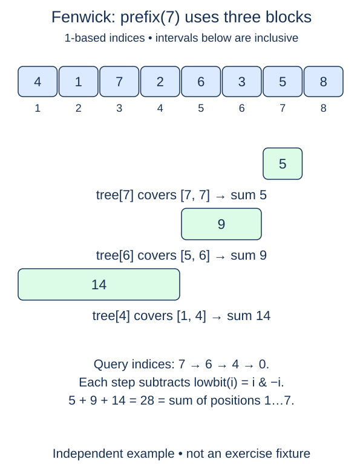

# Sum a Fenwick prefix

A prefix sum asks for all public values before a boundary. Our method `prefix(end)` returns the sum of positions in `[0, end)`. The argument is a count of included items, not the index of the last included item.

Valid boundaries satisfy `0 <= end <= n`. This includes n because the full sequence ends there, and zero because an empty prefix has sum zero. Out-of-range integer boundaries raise `IndexError`; non-integers raise `TypeError`.

## A boundary already names an internal cell

Unlike a point position, this exclusive boundary needs no plus-one conversion. Start the internal cursor at `end`. Add the stored block at that cursor to a running total, then subtract its lowbit. Repeat only while the cursor is positive. Zero stops the loop before a cell read, so `prefix(0)` returns the initial total.

For end 11, the visited cells are 11, 10, and 8. Their public intervals are `[10,11)`, `[8,10)`, and `[0,8)`. Together they cover `[0,11)` exactly once. The current cursor is the end of the portion not yet counted. Subtracting lowbit moves that boundary to the beginning of the block just consumed.

Adding one to end would include an extra public item or run beyond storage. Subtracting one at the beginning would omit the final requested item. These errors often hide when values are zero, which is why the probe and checks use different positive and negative additions.

Keep the supplied `add` and constructor methods. A query does not mutate the tree, and repeated queries must give the same answer until an update occurs. The method returns an integer total. It visits at most O(log(n+1)) blocks with O(1) extra variables in the bounded-cost arithmetic model. It does not slice or sum a separate original-value list.

## Worked trace



This figure numbers data positions from 1 and labels inclusive intervals. In our zero-based public API, its blocks [7,7], [5,6], and [1,4] mean [6,7), [4,6), and [0,4). Internal cell numbers stay 7, 6, and 4, and prefix(7) still includes exactly the first seven values. Do not add one to the query boundary.

## Small example

```python
index = 11
while index > 0:
    step = index & -index
    print((index-step, index))
    index -= step
```

Expected output:

```text
(10, 11)
(8, 10)
(0, 8)
```

## Supplied setup

The cursor starts at `end`, the total starts at zero, and the loop subtracts lowbit only while the cursor is positive. Those supplied lines handle index conversion and termination; your sum step consumes one block.

## Your Tasks

1. Reject non-integer or out-of-range `end` boundaries; zero and n are allowed.
2. Inside the supplied decreasing lowbit loop, add the current block to `total`.

## Run and check

Edit `main.py`, then press **Run** to inspect the supplied probe. Press **Submit** to check the operation on changed inputs and boundary cases. The probe is supplied. Complete the numbered steps in order; Submit checks each step separately.
