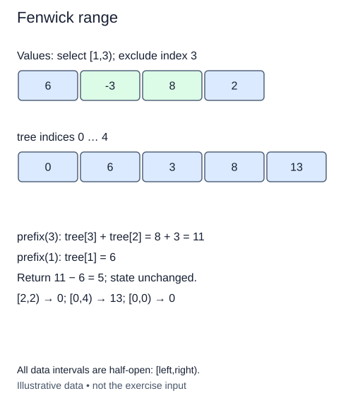

# Subtract prefixes for a range sum

The completed prefix query already sums from the beginning. A range query can reuse it instead of inventing another lowbit traversal. Keep the same half-open interval convention: `range_sum(left, right)` includes left and excludes right.

A valid interval satisfies `0 <= left <= right <= n`. The empty interval `[k,k)` is valid at any boundary k, including n, and sums to zero. A reversed interval is invalid even if both individual endpoints fall inside the sequence. Reject invalid integer intervals with `IndexError`, and non-integer boundaries with `TypeError`.

## Cancel the unwanted beginning

The prefix ending at right contains everything before left plus the requested interval. Subtract the prefix ending at left to cancel that unwanted beginning. Both prefix calls use boundary values directly; neither receives an added or subtracted one.

For a separate sequence `[8, 3, -2, 6]`, the sum of `[1,3)` is 1. The right prefix totals 9, the left prefix totals 8, and their difference is 1. The value at position three is excluded. If the two boundaries are equal, the same prefix is subtracted from itself.

Perform validation before computing the result. Merely calling `prefix` twice checks each boundary individually but does not reject left greater than right. Without the combined check, a reversed interval could return a plausible negative number even though it violates the interface.

This stage adds one small method to the existing class. It must not update cells or alter earlier query behavior. The tests compare every valid interval of several short sequences, including negative values, then repeat after a point addition. This catches accidental assumptions that range sums always increase with larger boundaries.

Two O(log(n+1)) prefix traversals are still O(log(n+1)) work, not O(log squared n), because their work adds rather than nests. Extra state remains constant apart from integer storage. The subtraction relies on sums having an inverse; a minimum query cannot be obtained by subtracting prefix minima.

## Worked trace



All data intervals are half-open: [left,right).

## Small example

```python
values = [8, 3, -2, 6]
print(sum(values[:3]) - sum(values[:1]))
print(sum(values[1:3]))
```

Expected output:

```text
1
1
```

## Your Tasks

1. Reject non-integer boundaries and intervals outside `0 <= left <= right <= n`.
2. Return the right prefix minus the left prefix.

## Run and check

Edit `main.py`, then press **Run** to inspect the supplied probe. Press **Submit** to check the operation on changed inputs and boundary cases. The probe is supplied. Complete the numbered steps in order; Submit checks each step separately.
