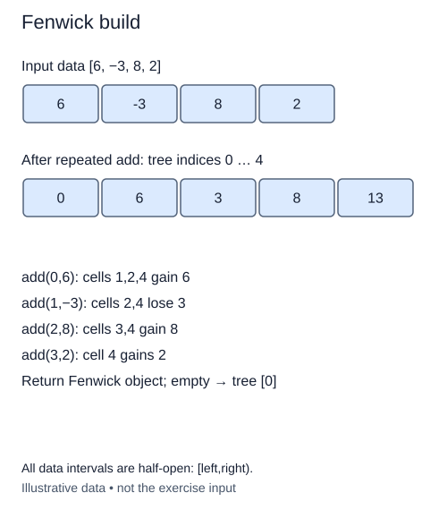

# Build a Fenwick tree from values

So far, callers allocate a zero sequence and add each initial value manually. Package that setup into `Fenwick.from_values(values)`. It is a class method: the supplied `@classmethod` decorator passes the class as `cls`, so the method can create and return a new instance.

The input is a list of integers. Construct a tree whose public size matches its length, then add each value at its zero-based position using the existing `add` method. Return the completed tree. Do not treat the original list as if it already contained Fenwick block totals.

## The representation is not a plain copy

For values `[6, 1, 4, 2, 7]`, the one-based stored cells are `[0, 6, 7, 4, 13, 7]`. Cell four contains the first four values; cell five contains only the fifth. Copying the input behind a leading zero would produce the right leaves at some positions but the wrong larger blocks.

Reusing `add` makes the construction rule easy to justify: before processing position p, the tree represents all earlier input values and zero at the remaining positions. Adding the next value preserves every partial-sum invariant. Once the loop finishes, it represents the whole sequence.

The constructor remains a size constructor. This new method does not replace or change it, so earlier lessons and callers still work. An empty input returns a tree with n zero and only the reserved storage cell. Mutating the input list afterward must not alter the constructed tree, and building twice must return independent objects.

The return hint `-> Fenwick` names the newly created object; postponed annotations allow that class name inside its own definition. The input hint `list[int]` states this lesson's supported numeric data. Existing validation rejects non-integer values when they reach `add`.

Repeated additions cost O(n log(n+1)) bounded-arithmetic work and O(n) storage. A linear-time construction exists, but it is not this exercise's algorithm. Avoid claiming O(n) merely because the outer loop visits each input once.

## Worked trace



All data intervals are half-open: [left,right).

## Small example

```python
values = [6, 1, 4, 2, 7]
print([0] + [sum(values[i-(i & -i):i]) for i in range(1, 6)])
```

Expected output:

```text
[0, 6, 7, 4, 13, 7]
```

## Supplied setup

The class-method decorator and return are supplied. Step 1 is checked by length and object independence, not by populated totals.

## Your Tasks

1. Create a new result tree with one public position per input value.
2. Visit the input positions and add each initial value through `result.add`.

## Run and check

Edit `main.py`, then press **Run** to inspect the supplied probe. Press **Submit** to check the operation on changed inputs and boundary cases. The probe is supplied. Complete the numbered steps in order; Submit checks each step separately.
