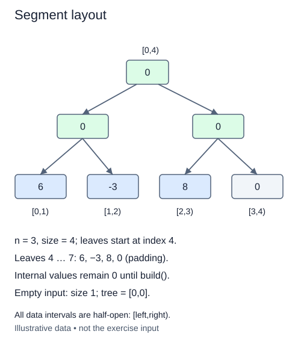

# Lay out a padded segment tree

A segment tree stores summaries for a hierarchy of intervals. Unlike prefix subtraction, its combination rule can support operations such as minimum. We begin a fresh class here; the completed Fenwick tree is a different representation, not something to convert in place.

Choose a leaf capacity `size` equal to the smallest power of two at least n, with a minimum capacity of one. Allocate `tree` with `2 * size` entries. Cell zero is unused; root cell one covers the padded interval `[0,size)`. The real values occupy leaf cells `size` through `size+n-1` in their original order.

## Separate real length from padded capacity

For five values, size is eight. Public item four lives at cell twelve, and leaves thirteen through fifteen are padding. Store n separately so later queries reject public boundaries beyond five even though storage exists there. A parent at cell i has children at 2*i and 2*i+1; an ordinary child's parent is i//2.

Each leaf covers a one-item interval. Every parent will combine two adjacent child intervals. Because capacity is a power of two, the splits are even down to the leaves. This regular shape is why we pad rather than force n itself into that layout.

The supplied `identity` is zero for sums, and `_combine` adds two summaries. Identity means combining it with any real summary leaves that summary unchanged. Fill all storage with the identity, then copy input values into the real leaves. Internal summaries intentionally remain unbuilt in this lesson; the next method will calculate them.

Empty input still has size one, n zero, and two identity entries. This makes later empty queries well-defined without creating a rootless special case. Do not retain the caller's list as storage. The hints `int | float` allow a later infinity identity; ordinary input values are integers.

Capacity is less than twice n when n is positive, so allocation is O(n) time and space. The doubling loop itself takes O(log(n+1)) steps. This task is layout only, not a complete query engine.

## Worked trace



All data intervals are half-open: [left,right).

## Small example

```python
capacity = 8
for position in range(5):
    print(position, capacity + position)
```

Expected output:

```text
0 8
1 9
2 10
3 11
4 12
```

## Supplied setup

The initial capacity of one is supplied. Each check reads only the state created so far: real length, capacity, storage, then populated leaves.

## Your Tasks

1. Record the real input length in `n`.
2. Double `size` from one until it can hold all real values.
3. Allocate a fresh `tree` list with `2 * size` identity entries.
4. Copy each input value into its real leaf at `size + position`.

## Run and check

Edit `main.py`, then press **Run** to inspect the supplied probe. Press **Submit** to check the operation on changed inputs and boundary cases. The probe is supplied. Complete the numbered steps in order; Submit checks each step separately.
