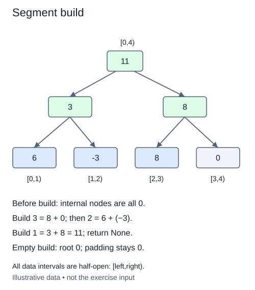

# Build parent summaries from the leaves

The constructor has placed values at the leaves and filled unused space with the identity. Internal cells still need their summaries. Add `build()` to the same class, leaving the layout and supplied addition rule unchanged.

The last internal cell is `size-1`. Visit internal cells backward down to one. At each cell, combine the summaries of its left child at twice the index and its right child at twice the index plus one. Store the result at the parent.

## Why backward order works

Both child indices are greater than their parent's index. By moving backward, you either read leaves that were already initialized or internal cells that were built earlier in this loop. Moving forward from the root would read unfinished child summaries and leave the root wrong even if the leaves were correct.

Take a padded four-leaf layout with real values `[7, 2, 5]`. The leaves are `[7, 2, 5, 0]`. Internal cell three combines 5 and 0 to get 5. Cell two combines 7 and 2 to get 9. Finally the root combines 9 and 5 to get 14. Padding contributes nothing because zero is the sum identity.

The loop stops before cell zero. For capacity one there are no internal cells below the root: the root is already the only leaf. The same empty loop therefore works for a singleton and for the empty layout. An empty sum tree's root remains zero.

Return `None` and mutate the summaries in place. Calling `build` twice must produce the same state rather than adding the existing totals again. Always compute a parent from its two children instead of incrementing the old parent. The input leaves and reserved cell zero must stay unchanged.

There are `size-1` internal cells, and size is O(n) for nonempty inputs. Build takes O(n) combination operations with O(1) auxiliary variables. It is not O(n log n): each internal node is processed once, rather than performing an update path for each leaf.

## Worked trace



All data intervals are half-open: [left,right).

## Small example

```python
leaves = [7, 2, 5, 0]
parents = [leaves[0]+leaves[1], leaves[2]+leaves[3]]
print(parents)
print(sum(parents))
```

Expected output:

```text
[9, 5]
14
```

## Supplied setup

The bottom-up loop is already written. This exercise asks for one parent assignment inside it, rather than rebuilding the layout or choosing the traversal order.

## Your Tasks

1. Inside the supplied reverse loop, set the parent to `_combine` of its two children.

## Run and check

Edit `main.py`, then press **Run** to inspect the supplied probe. Press **Submit** to check the operation on changed inputs and boundary cases. The probe is supplied. Complete the numbered steps in order; Submit checks each step separately.
