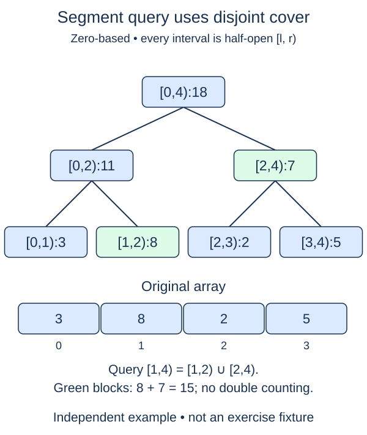

# Query a half-open segment interval

Build the tree before querying it. `query(left, right)` returns the summary of public `[left,right)`, where `0 <= left <= right <= n`. Invalid integer intervals raise `IndexError`; non-integer boundaries raise `TypeError`. Empty intervals return the identity, zero for this sum tree.

Convert both boundaries to leaf positions by adding `size`. Keep two accumulators initialized to the identity: one for accepted blocks from the left and one for accepted blocks from the right. The remaining interval is always half-open at the current tree level.

## Resolve the edges before moving upward

If the left boundary is odd, it is a right child. Its left sibling lies outside the query, so accept this boundary node alone and advance left by one. If the exclusive right boundary is odd, decrement it first, then accept that node: it is the left child immediately before the boundary. The right boundary itself is excluded and must not be read directly.

After handling those edges, both boundaries are even. Divide them by two to describe the same remaining interval at their parents' level. Stop when the boundaries meet. The accepted blocks never overlap, and no block extends beyond the original request.

With capacity eight and query `[1,6)`, leaf boundaries start at 9 and 14. Accept leaf 9 for `[1,2)`, then lift the remaining boundaries to 5 and 7. Accept cell 5 for `[2,4)` and cell 6 for `[4,6)`. The three blocks cover the requested interval exactly.

Combine left blocks onto the left accumulator and right blocks before the right accumulator, then combine both totals. Addition does not care about order, but preserving order makes the reasoning reusable. Use `_combine` and `identity` rather than hardcoding zero or addition in this method; a later minimum variant depends on that separation.

Each level consumes at most two boundary blocks, so a query uses O(log(n+1)) combinations and O(1) extra variables. Validate against real n, not padded size. Queries never mutate storage.

## Worked trace



Four real values already fill a power-of-two capacity, so this example needs no padding. The selected blocks [1,2) and [2,4) cover [1,4) without overlap; the right boundary remains excluded.

## Small example

```python
blocks = [(1, 2), (2, 4), (4, 6)]
print([i for left, right in blocks for i in range(left, right)])
```

Expected output:

```text
[1, 2, 3, 4, 5]
```

## Supplied setup

Leaf-boundary conversion, the two identity accumulators, the loop, halving both boundaries, and the final combination are supplied. The left-block check uses ranges that need no right-block consumption.

## Your Tasks

1. Reject non-integer boundaries or intervals outside the real sequence.
2. When the left boundary is odd, combine that node into `left_total` and advance left.
3. When right is odd, decrement the exclusive boundary and combine that node before `right_total`.

## Run and check

Edit `main.py`, then press **Run** to inspect the supplied probe. Press **Submit** to check the operation on changed inputs and boundary cases. The probe is supplied. Complete the numbered steps in order; Submit checks each step separately.
