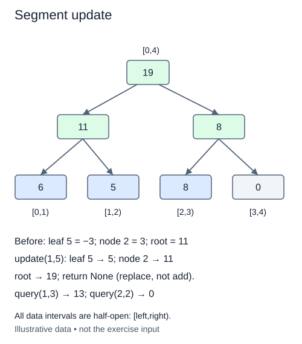

# Replace a value and repair its ancestors

A built segment tree can change one value without rebuilding every interval. This method is an assignment: `update(position, value)` replaces the old public item. It differs from Fenwick's `add`, which applies a delta.

Validate that the integer position satisfies `0 <= position < n`, and that the new value is an integer. Invalid positions raise `IndexError`; non-integer position or value raises `TypeError`. Padding positions are not real items even though their leaves exist in storage. Reject them before changing anything.

## Repair the path that contains the changed leaf

The leaf cell is `size + position`. Replace that cell, then move to its parent with integer division by two. Recompute that parent from both child summaries using `_combine`. Continue upward until you have recomputed root cell one. Stop before cell zero.

For capacity eight and public position two, the leaf is ten. The ancestor path is 5, 2, 1. Cells outside this path summarize intervals that do not include position two, so their values remain correct. Reading both children during repair handles either an increase or decrease and also supports the later minimum variant.

Do not add the new value to every ancestor. An assignment does not tell you the delta until you compare with the old value, and a generic combination such as minimum has no subtraction-based repair rule. Recombining children is the reliable invariant: each internal node always equals the combination of its current children.

Build is supplied and must be called before using updates or queries. A singleton has its root at the leaf itself, so replacing that cell completes the update and the ancestor loop has no iterations. Empty trees have no valid point updates. Replacing a value with itself is harmless.

Return `None`. A point replacement takes O(log(n+1)) combination operations with constant auxiliary state, assuming bounded-cost arithmetic. Queries after several replacements must reflect the latest values, not an original input snapshot. Another independently built tree must remain unchanged.

## Worked trace



All data intervals are half-open: [left,right).

## Small example

```python
index = 8 + 2
print("leaf", index)
index //= 2
while index:
    print("parent", index)
    index //= 2
```

Expected output:

```text
leaf 10
parent 5
parent 2
parent 1
```

## Supplied setup

The leaf-index calculation, move to the first parent, and upward loop are supplied. The leaf check deliberately ignores stale parent summaries until the final step.

## Your Tasks

1. Reject non-integer arguments or positions outside the real sequence before mutation.
2. Replace the selected leaf with the new value, rather than adding it.
3. Inside the supplied ancestor loop, recompute the parent from its two children.

## Run and check

Edit `main.py`, then press **Run** to inspect the supplied probe. Press **Submit** to check the operation on changed inputs and boundary cases. The probe is supplied. Complete the numbered steps in order; Submit checks each step separately.
