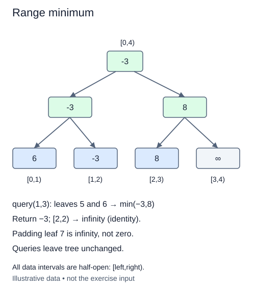

# Use minimum as the segment summary

Sum is only one summary that adjacent segments can combine. The minimum of two neighboring intervals is the smaller of their minima. That rule is associative: changing how the intervals are grouped does not change the answer. A segment tree can therefore use it with the same interval layout.

The completed `SegmentTree` is supplied unchanged. A new `MinTree` subclass inherits its constructor, build, query, and update. The subclass supplies a different identity and asks you to implement only its combination rule. This is an explicit variation, not a change to sum behavior.

## An empty interval must not win

Zero is the identity for addition but not for minimum. If every real value is positive, combining a padded zero with the data would invent a smaller answer. Use positive infinity instead. Python spells it `float('inf')`; the supplied subclass sets this identity already. Minimum of a real integer and infinity is that integer.

For real leaves `[12, 5, 9]`, padding produces `[12, 5, 9, infinity]`. The right parent is 9, not zero. The root is 5. Querying `[3,3)` returns infinity because it contains no real values. This is a defined empty result, not an error or a claim that infinity was present in the input.

The inherited constructor reads `self.identity`, and the inherited algorithms call `self._combine`, so ordinary method lookup selects the subclass behavior. Do not override `query` with a direct slice minimum. The exercise is to reuse the hierarchy with a different summary.

The result hint `int | float` means an integer minimum for nonempty intervals or a floating infinity for empty ones. Inputs and updates remain integers. Negative values work without special cases. Updating the current minimum upward must allow another value to become the minimum, which is why ancestors recompute from both children rather than merely remembering the smallest value ever seen.

Build remains O(n), and queries and point replacements remain O(log(n+1)) combinations. Storage is still O(n). Counts assume bounded-cost numeric comparisons.

## Worked trace



All data intervals are half-open: [left,right).

## Small example

```python
print(min(9, float("inf")))
print(min(float("inf"), float("inf")))
```

Expected output:

```text
9
inf
```

## Supplied setup

The infinity identity and inherited operations are supplied. Only the one-line combination rule is new.

## Your Tasks

1. Return the smaller of `left` and `right` in the supplied minimum subclass.

## Run and check

Edit `main.py`, then press **Run** to inspect the supplied probe. Press **Submit** to check the operation on changed inputs and boundary cases. The probe is supplied. Complete the numbered steps in order; Submit checks each step separately.
