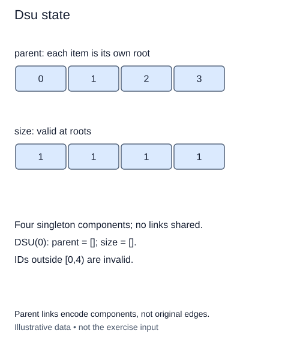

A repair team wants to record which service sites already share a cable. At first, none of the sites are connected. A disjoint-set structure stores this partition: every site belongs to exactly one group, and groups do not overlap.

Use integer site IDs from `0` through `n - 1`. The list `parent` stores one link per site. A root points to itself. Following links from any other member must eventually reach a root; a loop between different sites would break this rule. The root is a representative, not a special or preferred site.

For example, four initially separate lockers have parent links `[0, 1, 2, 3]`. If locker 3 later points to locker 1, they share a group. That change does not say which locker is physically closer. Parent links describe membership, not cable routes.

The constructor also creates `size`, initially one for each site. Later, only entries at roots will describe whole component sizes. Allocating both lists now gives the later lessons a stable representation. Each instance needs its own lists: changing one repair plan must not alter another.

The supplied `_check` method rejects unknown IDs with `IndexError`. You will use it when implementing lookup. The constructor itself must reject negative sizes and non-integer sizes with `ValueError`; booleans are excluded even though Python treats them as integer-like values. A zero-size structure is valid and has two empty lists.

Building the state takes O(n) time and O(n) space. Nothing here searches for connections yet. Run the checkpoint to see the initial parent and size lists; the next lesson follows those links.

Read each parent value at its site index. Parent links record membership, not the physical cables.

## Build it in small steps

The constructor is already wired to three helpers. `@staticmethod` means a helper does not receive `self`; you can call it on `DisjointSet` before an instance exists. First validate n. The other helpers receive that valid n and build the separate parent and size lists. You only edit those three helper bodies.

## Your Tasks

1. Complete `validate_size(n)` to reject negative sizes, booleans, and non-integers with `ValueError`.
2. Complete `initial_parents(n)` to return a fresh self-linked parent list for a valid n.
3. Complete `initial_sizes(n)` to return a fresh list of n ones for a valid n.

Edit `main.py`. Run shows the parent and size lists for three independent sites. Submit checks the same operation on additional small cases.
