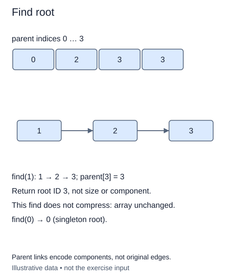

Two sites belong to the same component when their parent chains end at the same root. Comparing their immediate parents is not enough: a chain can contain several links.

Suppose a small set has parent links `[0, 0, 1, 3]`. Starting at site 2, the trace is `2 → 1 → 0`. Site 0 points to itself, so it is the representative. Site 3 is still separate. A root lookup returns an ID; it does not return a list of all members.

The supplied `find(item)` validates the ID, then delegates link traversal to your helper. The loop invariant is that the current item remains in the original item's component. Every move follows an existing parent link, so the invariant holds. Our valid structures are forests: their chains always end at self-links.

This first version must leave `parent` unchanged. Keeping lookup read-only makes the initial algorithm easy to trace. A later method will shorten paths deliberately. Do not assume the representative is the smallest ID. A valid chain could end at any member, and the tests include a component whose root is not zero.

An unknown ID raises `IndexError`, including a negative ID that Python would otherwise interpret as indexing from the end. `_check` already handles this contract. Empty structures have no valid IDs.

If the chain has height h, lookup takes O(h) time and O(1) auxiliary space. Without balancing, h can grow to O(n). This is not yet a constant-time operation. The checkpoint supplies a valid chain because joining groups is the next lesson; those parent assignments are a trace fixture, not a substitute for the method you are writing.

The representative need not be the smallest ID. This read-only lookup leaves the separate root 0 untouched.

## Build it in small steps

The supplied `find` wrapper uses the existing `_check` validator, then calls `root_from`. First write the one-link predicate; then write the traversal. The traversal test supplies a working predicate so it checks only your loop.

## Your Tasks

1. Complete `is_root(item)` to return whether a valid item points to itself.
2. Complete `root_from(item)` to follow a valid parent chain until `is_root` is true; leave every link unchanged.

Edit `main.py`. The supplied chain ends at site 0; Run should print its representative. Submit checks the same operation on additional small cases.
