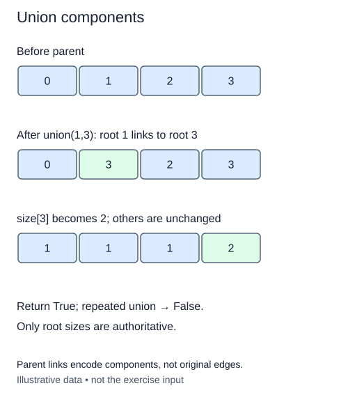

A new cable joins all sites in one component to all sites in another. You only need to change one root link. Rewriting every member would waste work.

First find both representatives. If they match, the sites already share a component: return `False` and leave the partition unchanged. Otherwise link one root below the other and return `True`. Either root may win in this unbalanced version. The return value describes whether the partition changed, not which site became the representative.

For example, imagine groups `{0, 4}` and `{1, 2}`. Joining sites 4 and 2 must join both entire groups. Assigning `parent[4] = 2` directly is unsafe because 4 might not be a root; moving a non-root could detach only part of a group. Finding roots first avoids that mistake.

The supplied `_link(child, root)` helper performs the small bookkeeping change: it links the first root to the second and adds the child's size to the surviving root's size. Sizes at non-roots are deliberately left stale. Only root sizes are meaningful. Both arguments to this private helper must be distinct roots; your `union` method establishes that precondition.

The completed constructor and lookup remain in this editor. You do not need another lesson's files. Validate both IDs through `find` before linking anything, so a rejected second ID cannot leave a half-applied merge.

This version has no balancing rule. Two root lookups dominate its O(h) cost, which can be O(n); the link itself is O(1). The storage remains O(n). Repeating a merge or joining a site to itself is a normal no-op, not an error. Run the checkpoint and compare representative equality rather than expecting a particular printed root.

This trace uses the reference choice `_link(root_a, root_b)`. Either root may win in the unbalanced exercise; connectivity and the surviving size must agree.

## Build it in small steps

The public `union` method is supplied as a two-step pipeline. Resolve endpoints first, then merge roots. `merge_roots` receives roots, not arbitrary member IDs; its task is the small state change, not another search.

## Your Tasks

1. Complete `union_roots(a, b)` to return both validated representatives without changing links.
2. Complete `merge_roots(root_a, root_b)` to return `False` for equal roots, or link the distinct roots with `_link` and return `True`.

Edit `main.py`. Run should report a successful merge and then equal representatives. Submit checks the same operation on additional small cases.
