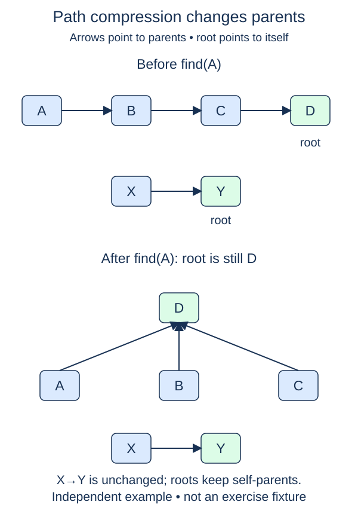

A root lookup can do useful maintenance. After finding the root, every site on the path can point directly to it. Future lookups then cross fewer links without changing component membership.

Keep the earlier read-only `find` method. Add a separate `find_compressed` method so you can compare the two behaviors. This is full path compression: every visited non-root must point directly to the final root after the call. Path halving is another valid design, but it is not the operation being practiced here.

Consider `5 → 3 → 1 → 1`. The root is 1. Compression replaces the links from 5 and 3 with links to 1. The root remains 1, and a separate component is untouched. The size stored at the root remains correct because no site moved to a different component.

An iterative two-pass approach is convenient. First walk to the root. Then walk the original path again, saving each old parent before overwriting it. Without that saved link, jumping to the newly assigned root would skip the remaining nodes. You could instead record the visited IDs and repair them afterward, but that uses extra path storage.

Use `_check` to reject invalid IDs before reading a link. A root lookup on a singleton should return that root without changing its state. Do not change `size`: shortening links does not change the number of members.

A single call still takes O(h) time for the original path. The two-pass version needs O(1) auxiliary space. We have not yet combined compression with a balancing rule, so do not attach the later inverse-Ackermann bound to this stage. The checkpoint shows the parent list after compression, where the maintenance work is visible.

The letters stand for site IDs in this independent example. Its `find(A)` means our `find_compressed` operation; the earlier read-only `find` does not rewrite links.

## Build it in small steps

The supplied wrapper finds the root with the earlier read-only traversal. Your first helper changes one link without losing the old path. Your second helper repeats that operation to the root. Neither helper should change component sizes.

## Your Tasks

1. Complete `redirect_parent(item, root)` to set one parent link and return its old value.
2. Complete `compress_to(item, root)` to redirect the whole original path by repeatedly using the old parent returned by `redirect_parent`.

Edit `main.py`. Run shows both the root and the shortened parent links. Submit checks the same operation on additional small cases.
