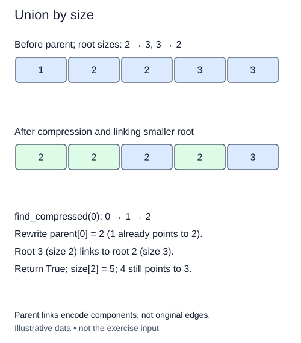

Compression repairs paths that you visit. Union by size prevents unnecessarily tall paths from being created in the first place.

The supplied `union_by_size(a, b)` keeps the earlier unbalanced `union` for comparison. Use `find_compressed` for both endpoints. If their roots differ, attach the smaller component's root below the larger component's root. Either choice is allowed when their sizes tie. `_link` already updates the winning root's size, so do not add the same size twice.

Suppose one group contains six sites and another contains two. Attaching the larger group below the smaller one would make six sites deeper. Attaching the smaller group makes only two sites deeper. Each time a node's depth grows under the size rule, its new component is at least twice as large. Without compression, that gives logarithmic height.

The `size` list is not a depth list. Read sizes only at the roots you just found. A stale size at an ordinary member does not describe that member's current component. The existing unbalanced method also keeps root sizes correct, so it is safe to inspect a structure assembled in earlier lessons; the strongest performance bound below assumes the size rule is used throughout the operation sequence.

For a sequence built with union by size and path compression, find and union have amortized O(α(n)) cost, where α is the inverse Ackermann function. It grows extremely slowly. Amortized describes the sequence average, not a strict constant-time guarantee for every individual call. Initialization still takes O(n) time and space.

Repeated unions return `False`, including a site joined to itself. Tests compare connectivity and component sizes rather than a chosen root ID. The size policy is checked only when the sizes differ, where its direction has a real structural meaning.

For this trace, call `union_by_size(0, 3)`. Site 4 still points through 3, and only the surviving root size becomes five; compression need not visit every member.

## Build it in small steps

The existing `merge_roots` already handles equal roots and size bookkeeping. The supplied union wrapper connects two new decisions: compress both endpoint paths, then order their roots by size. You do not rewrite merging.

## Your Tasks

1. Complete `compressed_roots(a, b)` by looking up both endpoints with `find_compressed`.
2. Complete `smaller_first(root_a, root_b)` to return the root of the smaller component first. Either order is allowed for equal sizes.

Edit `main.py`. The checkpoint builds a four-member group and prints its root size. Submit checks the same operation on additional small cases.
