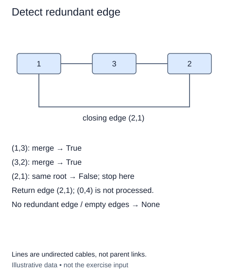

Suppose cables arrive one at a time. A cable is redundant for connectivity if its endpoints already belong to the same component. The disjoint-set structure lets you detect that moment without rebuilding a graph traversal after every arrival.

`first_redundant(n, edges)` is supplied as a function outside the class. Each edge is an undirected pair of integer IDs. Process the supplied list in order using a fresh `DisjointSet`. A successful `union_by_size` means the cable connected two separate groups. A failed union means an existing path already connects its endpoints; return that edge as a tuple immediately. Return `None` when every edge contributes a connection.

For example, after cables `(0, 3)` and `(3, 5)`, cable `(5, 0)` closes a cycle. The third cable is the first redundant one even if a later cable would be cheaper. This function knows nothing about weights or optimality.

We treat the input as an undirected multigraph. A repeated edge, including its reversed orientation, is redundant once the first copy has connected its endpoints. A self-loop is redundant immediately. These policies are explicit because a simple-graph cycle detector may instead discard duplicate input edges.

All endpoint IDs must exist. The supplied `_validate_edges` helper validates the entire list before processing, so an invalid later edge still raises `IndexError` even if an earlier edge is redundant. It accepts pairs here; the next lesson uses its weighted mode for triples. Each edge may be a list or tuple inside the outer edge list. The caller's collection is not modified.

For E edges and n sites, initialization and validation take O(n + E), followed by amortized O(E α(n)) union work. Auxiliary space is O(n). DSU detects undirected connectivity cycles; applying this rule to directed edges would answer a different question.

These are undirected cables, not DSU parent arrows. A later cable (0, 4) is validated with the input but never unioned after the first redundant edge is found.

## Build it in small steps

The supplied loop validates the full edge list, processes edges in arrival order, and stops at the first redundant edge. Your helpers supply its connectivity decision and its tuple result. A failed union is the redundant case, so the boolean is the inverse of union success.

## Your Tasks

1. Complete `edge_is_redundant(groups, a, b)` to attempt a union and return whether it failed.
2. Complete `edge_pair(a, b)` to return the original endpoint orientation as a tuple.

Edit `main.py`. The checkpoint should identify the edge that closes the first cycle. Submit checks the same operation on additional small cases.
