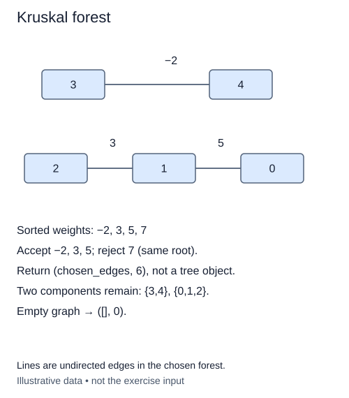

Now each possible cable has a cost. Connect every group that can be connected while paying as little as possible. If the network is disconnected, the answer is a minimum spanning forest: one minimum spanning tree per connected component, plus any isolated sites.

Kruskal's algorithm considers edges from cheapest to most expensive. Accept an edge only when its endpoints currently have different roots. Accepted edges never create a cycle. The greedy choice is safe because the cheapest available edge crossing a component boundary can be included in some minimum spanning forest.

For a small example, links `(1, 4, 2)` and `(4, 6, 3)` are accepted before `(1, 6, 9)`. The expensive link is then redundant. A separate pair of sites still needs its own cheapest connection; do not stop merely because one component is complete.

The supplied `kruskal_forest(n, edges)` returns `(chosen, total)`. Each input triple is an undirected cable `(a, b, weight)`, and `chosen` contains accepted triples, preserving endpoint orientation. Sort by weight only. Python's stable sorting preserves input order for equal weights; this is our explicit output-order contract. Do not sort the caller's list in place. Parallel edges and self-loops are allowed. A self-loop is never accepted. Negative and zero integer weights are valid here: unlike Dijkstra, Kruskal does not require nonnegative costs.

The supplied validator checks all endpoints and integer weights before work begins. Empty input returns `([], 0)`, even with isolated vertices. The number of accepted edges is n minus the number of final components, not always n minus one.

Sorting costs O(E log E); DSU adds O(n + E α(n)) amortized work. This implementation stores a sorted edge copy and the forest, using O(n + E) auxiliary space. You can now choose cables by cost while the DSU keeps track of which sites are already connected.

The picture shows the accepted forest for edges (3, 4, -2), (2, 1, 3), (1, 0, 5), and (2, 0, 7). The weight-seven edge is omitted because it would close a cycle. Endpoint order in a tuple does not make a cable directed.

## Build it in small steps

The supplied public function validates inputs and connects three helpers. Check sorting, cycle avoidance, and totaling separately. `choose_forest_edges` receives edges that are already sorted; do not make it sort again.

## Your Tasks

1. Complete `ordered_edges(edges)` to return a stable, ascending-weight copy.
2. Complete `choose_forest_edges(groups, edges)` to retain only edges whose union succeeds, in the supplied order.
3. Complete `forest_weight(chosen)` to total the accepted weights.

Edit `main.py`. Run prints the accepted weighted edges and their combined cost. Submit checks the same operation on additional small cases.
