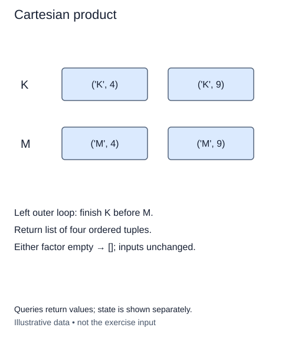

A print workshop offers a choice of paper and a choice of finish. A Cartesian product pairs every paper with every finish. The positions have different roles, so `(paper, finish)` is an ordered pair, not a two-element subset.

`object` in the type hints allows option values of different types. `tuple[object, object]` describes a pair. Later, `tuple[object, ...]` describes a tuple of any length; the three dots are type notation, not missing code.

For example, papers `['linen', 'kraft']` and finishes `['plain']` produce `[('linen', 'plain'), ('kraft', 'plain')]`. The first input changes slowly: finish all choices from the second input before moving to the next item in the first. This left-major order is part of the contract.

Use two nested loops and append a tuple for each pair. At the start of an outer-loop iteration, all pairs belonging to earlier first-input items have already been produced. The inner loop then adds exactly the pairs for the current first item. There is no selection-without-replacement restriction across the two inputs: if both contain the same value, that value may appear in both positions.

An empty input gives no pairs, so return `[]` if either side is empty. This differs from choosing zero items, which will produce one empty selection in later lessons. Validate both inputs even when the other is empty.

For input lengths a and b, output construction takes O(ab) time and output space. Validation in this teaching helper uses O(a² + b²) equality comparisons; these small bounds are deliberate. Keep examples small instead of printing an enormous product.

The supplied `_options` helper copies the input and rejects duplicate values or more than eight options with `ValueError`. Inputs are ordered lists or tuples, not unordered sets. Distinct options keep value identity separate from the question of whether a choice may be reused. Do not mutate the input. Write the row-building helpers without `itertools`; the loop structure is what you are practicing.

Read the top row before the bottom row. Left-major order follows the supplied input order, not a sort of the values.

## Build it in small steps

Input validation is supplied in `cartesian_product`. Build one row first, then the outer loop that joins rows. The second test provides a correct row builder so it checks only the outer loop.

## Your Tasks

1. Complete `pair_row(first, right)` to pair one first value with each right-hand value in order.
2. Complete `product_rows(left, right)` to join one `pair_row` per left-hand value, preserving left-major order.

Edit `main.py`. Run shows four pairs, with the first input changing slowest. Submit checks the same operation on additional small cases.
