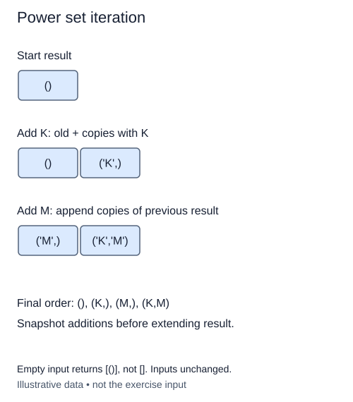

A workshop can pack any selection of optional tools, including none. The power set contains every subset, regardless of size. Within a subset, selection order does not matter; we store members in their original input order to give each subset one consistent representation.

Start with a list containing one empty tuple: `[()]`. This is one selection, not zero selections. For each option, keep every existing subset and create one new subset that includes that option. Each old subset therefore produces two possibilities: exclude the item or include it.

With options `['clip', 'ruler']`, processing the clip gives `[(), ('clip',)]`. Processing the ruler keeps those two results first, then appends `('ruler',)` and `('clip', 'ruler')`. This doubling order is required; it will match ascending masks in the next lesson.

Read from a snapshot of the old results when extending them. Appending to the same list you are iterating can keep generating new work indefinitely. Tuple concatenation makes a new tuple, so earlier subsets are not accidentally changed. A one-item tuple needs its trailing comma, as in `('ruler',)`.

There are 2**n subsets, but materializing their members takes O(n 2**n) total time and output space for n > 0. A compact count is much cheaper than enumerating the actual objects. Our helper caps n at eight, and the checkpoint uses only two options. The empty input returns `[()]` because there is exactly one way to choose nothing.

Keep the input as an ordered list or tuple of at most eight distinct values. `_options` supplies a copy and raises `ValueError` for duplicate or oversized input. Write the doubling step yourself rather than calling `itertools`; leave the original options unchanged.

The M row shows only the new additions. Append them after the two old results; do not replace the old results.

## Build it in small steps

The doubling loop and empty-subset seed are supplied. First create one extended tuple. Then create the whole additions list without modifying the list you are reading. The outer loop appends those additions only after your helper returns.

## Your Tasks

1. Complete `append_choice(subset, value)` to return a new tuple ending in value, without changing subset.
2. Complete `subsets_with(subsets, value)` to build a separate list of extended subsets in the old order.

Edit `main.py`. Run shows four subsets, beginning with the empty tuple. Submit checks the same operation on additional small cases.
