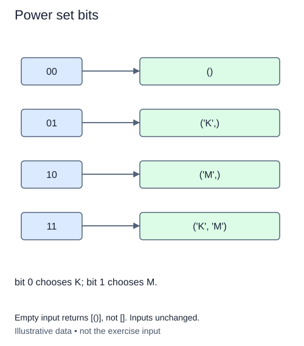

The same family of subsets can be represented by binary decisions. Bit i says whether input item i is present. A zero bit excludes it; a one bit includes it. This lesson starts a fresh implementation so you can compare masks with the previous doubling algorithm.

For options `['glue', 'file', 'brush']`, mask `0b101` selects the glue and brush. Bit zero belongs to the first item, even though binary numbers are written with the highest bit on the left. Build each tuple by scanning indices upward, so its members retain input order.

Visit masks in `range(1 << n)`. The stop value is excluded. Mask zero contributes the empty tuple, while the final mask selects every item. Appending tuples in ascending mask order produces the same output order as the previous lesson. Do not sort subsets alphabetically; input order may have a deliberate meaning.

The expression `mask & (1 << i)` tests whether bit i is set. Python integers are not restricted to a fixed 32-bit width. That does not make it sensible to enumerate huge power sets: the number of masks still doubles with each additional item. `_options` keeps this exercise bounded.

Scanning n positions for each of 2**n masks takes O(n 2**n) time under this small-integer cost model. The returned member references take the same asymptotic output space. Only one temporary subset needs to be assembled at a time, requiring O(n) working space beyond the output. Empty input still visits mask zero once and returns `[()]`.

Use the supplied `_options` validator for an ordered list or tuple of at most eight distinct values. Duplicate or oversized input raises `ValueError`. This version must use bit tests, not delegate subset generation to `itertools`, and must leave the input unchanged.

Bit zero selects K, the first input item. Ascending masks reproduce the preceding doubling order.

## Build it in small steps

The supplied outer loop visits all masks in ascending order. Your first helper answers one membership question. Your second helper turns those answers into one subset; it must not reorder the input values.

## Your Tasks

1. Complete `selected_bit(mask, index)` to return a boolean using a bit test.
2. Complete `subset_for_mask(values, mask)` to collect selected values in input order as a tuple.

Edit `main.py`. Compare the Run order with the preceding doubling lesson. Submit checks the same operation on additional small cases.
