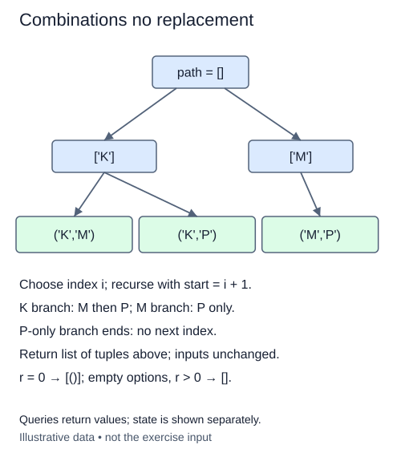

Choose a small inspection team from an ordered roster. The team has no first or second position, and one person cannot occupy two places. These are combinations without replacement. Let n be the number of available people and r the required team size.

A search path records the chosen items. Carry a `start` index that marks the first option still allowed. After choosing index i, recurse with i + 1. Indices therefore increase strictly, preventing both reuse and reversed duplicates. Save a tuple when the path length reaches r, then backtrack by removing the last choice.

For example, choosing two of `['Mira', 'Sol', 'Tess']` first explores teams beginning with Mira, then the team beginning with Sol. It never generates the same team again with Tess first. Output follows lexicographic order of input indices, not alphabetical order of names. Keep every tuple in that same input order.

A nested helper can read the enclosing `values`, `result`, and `path` variables. Appending and popping mutate those shared lists; each call does not create a separate path. Make a tuple copy only when saving a finished selection.

A branch with too few remaining options cannot reach a leaf. The supplied driver lets its loop run out naturally. A later optimization could prune that branch sooner by comparing remaining options with remaining places.

The supplied `_length` helper accepts only integer r from zero through six, excluding booleans. Choose zero items by returning `[()]`, even from an empty roster. If r exceeds n, return `[]`. Validation still runs first.

There are C(n,r) results when 0 <= r <= n. This binomial coefficient is n! divided by r!(n-r)!; it counts selections while ignoring their order. Storing them costs O(r C(n,r)) member references for r > 0. Search work depends on visited prefixes; a conservative bound for this loop-based implementation is O(n times the number of visited prefixes), plus tuple copies. The recursion uses O(r) stack and path space. Keep the requested sizes small; Python recursion is not stack-free.

Use `_options` to copy an ordered list or tuple of at most eight distinct values; it rejects duplicates and larger inputs with `ValueError`. Keep that input unchanged and write the backtracking yourself rather than importing the finished operation from `itertools`.

Read leaves left to right in input-index order. The P-only branch runs out of later indices; the supplied driver does not implement an early remaining-count prune.

## Build it in small steps

The supplied driver appends a choice, asks your boundary helper where the next call starts, and pops the choice on return. At a completed leaf it calls your snapshot helper. Trace those calls before editing: advancing past the chosen index is what forbids reuse.

## Your Tasks

1. Complete `distinct_next(index)` to return the first index allowed after choosing an item without replacement.
2. Complete `distinct_snapshot(path)` to save the completed selection as an independent tuple.

Edit `main.py`. Run shows each two-site selection once, in input-index order. Submit checks the same operation on additional small cases.
