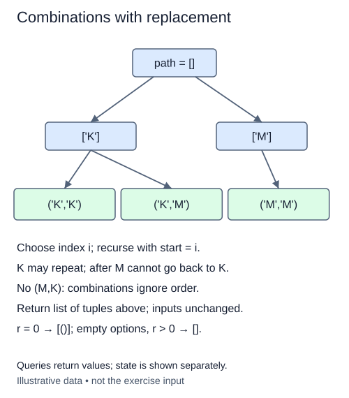

A workshop can order several rolls of the same tape. The order on the purchase form does not matter, but quantities do. Combinations with replacement permit repeated choices while still avoiding reordered duplicates.

Use a fresh search function rather than changing the previous no-replacement version. Its path and `start` index have nearly the same roles. The difference is what remains legal after choosing index i: recurse with i, not i + 1. The current option stays available. Indices never decrease, so a choice made earlier in the roster cannot appear after a later one.

For example, a two-roll order from `['paper', 'cloth']` can be paper-paper, paper-cloth, or cloth-cloth. Cloth-paper would describe the same quantities as paper-cloth, so it is omitted. Output is lexicographic by input index, and members within each tuple follow nondecreasing input index.

Replacement describes permission to reuse an option, not duplicate entries in the source list. The supplied validator still rejects a roster containing the same value twice. Keeping the input distinct prevents one quantity choice from being generated through two source positions.

The base case remains path length r. Return `[()]` for r = 0, including an empty option list. With no options and r > 0, return `[]`. `_length` restricts r to integer values from zero through six. You cannot prune just because fewer than r distinct options remain: a single available option may fill every remaining place.

For n > 0, the number of results is C(n+r-1,r). Output takes O(r times that count) member space for positive r. A conservative time bound is O(n times visited prefixes), plus output copies; recursion and the current path use O(r) space. Keep test selections small even when their count is easy to calculate.

The ordered input is a list or tuple with at most eight distinct values. `_options` copies it and rejects duplicates or larger inputs with `ValueError`. Reuse choices during your search, not by changing that input or delegating to `itertools`.

Keeping the chosen index available allows repeats. Never decreasing the index prevents a reordered duplicate.

## Build it in small steps

This driver keeps the previous lesson's recursion shape but changes the allowed next index. It appends a choice, asks your boundary helper where the next call starts, and pops the choice on return. At a completed leaf it calls your snapshot helper. Trace those calls before editing. Keeping the chosen index available permits reuse.

## Your Tasks

1. Complete `repeated_next(index)` to return the first index allowed after choosing an item with replacement.
2. Complete `repeated_snapshot(path)` to save the completed selection as an independent tuple.

Edit `main.py`. Run should include two copies of the same finish as a valid selection. Submit checks the same operation on additional small cases.
