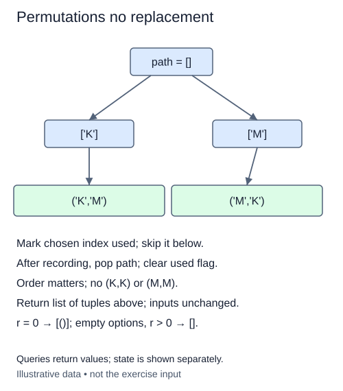

An inspection route assigns a different site to each stop. Changing the stop order changes the route. These are permutations without replacement, unlike the unordered teams from the combination lessons. Here n is the number of sites and r is the number of stops.

The increasing `start` boundary no longer works. A later stop may use an earlier input index, provided that index has not already been used. Keep a boolean `used` list alongside the current path. At each depth, try unused indices from left to right. Mark an index before recursing, then unmark it when you backtrack.

For example, with sites `['shed', 'dock', 'lab']`, a route beginning at dock may next visit shed. The route shed-dock and the route dock-shed are different results. By trying indices in input order at every depth, output follows lexicographic order of index tuples. It does not sort the site names.

The invariant is that every marked index appears exactly once in the current path. Backtracking must restore both the path and the marker. If you pop the item but leave its marker set, later branches silently lose valid routes. Store `tuple(path)` at a leaf so later changes to the working list cannot alter a saved result.

For r = 0, return `[()]`; for r > n, return `[]`. The supplied validators require distinct options and integer r from zero through six. This implementation generates length-r arrangements, not only arrangements of all n items. When r = n it generates all n! orders.

There are n!/(n-r)! results for valid r. Storing them uses O(r times the result count) member space. At each visited prefix this version scans n candidate positions, so allow O(n times visited prefixes) work plus output copying. The markers and path use O(n+r) space. This staged driver also keeps a candidate-index list at each active depth, so total working space is O(nr+r).

Pass an ordered list or tuple through `_options`; it copies at most eight distinct values and rejects duplicates or oversized input with `ValueError`. Restore your own search state after each branch instead of editing the source roster. Implement the search without `itertools`.

Both leaves are required because order matters. Restore the marker as well as the path before exploring the next branch.

## Build it in small steps

The recursive driver handles leaf snapshots and call order. You implement its three small state operations: list unused positions, make one choice, and undo that choice. Appending the value and marking its index are one state transition; releasing reverses that same transition.

## Your Tasks

1. Complete `unused_indices(used)` to list available indices in increasing input order.
2. Complete `choose_position(values, index, path, used)` to append that value and mark its position used.
3. Complete `release_position(index, path, used)` to undo the most recent choice and clear its marker.

Edit `main.py`. Run shows why swapping the two route positions creates a different result. Submit checks the same operation on additional small cases.
