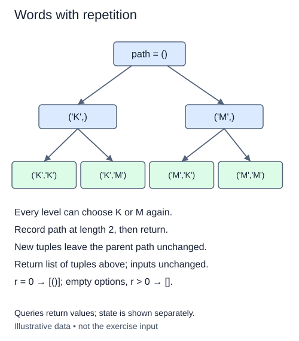

A status panel displays a short sequence of symbols. Each position may use any symbol, including one used earlier. Order matters and repetition is allowed. These are fixed-length words, or equivalently a repeated Cartesian product.

This is different from rearranging an existing multiset. A multiset permutation would have fixed quantities, such as exactly two circles and one square. Here the available symbols are a distinct alphabet, and each position independently chooses from that alphabet.

For an alphabet `['up', 'down']` and two positions, the words are up-up, up-down, down-up, and down-down. Try symbols in input order at every depth. The leftmost position changes slowest, matching lexicographic order of input indices. We return tuples, even when symbols happen to be strings; joining them would lose boundaries for multi-character symbols.

No used-index list is needed. Extend a tuple path with a candidate and recurse to the next position. Record the tuple when its length reaches r. The search tree has one level per position and one outgoing branch per alphabet symbol. Tuple paths are independent, so returning from a call restores the earlier path without a pop.

The empty word is one result: r = 0 returns `[()]` even with an empty alphabet. If r is positive and the alphabet is empty, there are no words. The validators cap the alphabet at eight distinct options and r at six; use much smaller checkpoints rather than printing the upper bound.

For n symbols and r positions there are n**r words. For n >= 2 and positive r, construction takes O(r n**r) time and output space. With a single symbol, repeatedly copying longer tuple paths takes O(r²) time even though there is only one output word. The copying variation can retain O(r²) tuple-path space across the recursive stack. When you only need a count, compute the count instead of constructing all those tuples. Large-integer arithmetic itself is not literally constant-time.

Use `_options` for an ordered list or tuple of at most eight distinct symbols. It copies the input and raises `ValueError` for duplicates or oversized input. Keep the alphabet unchanged and build the words yourself rather than calling `itertools`.

Each extension creates a new tuple. Returning restores the parent call naturally; this driver does not mutate a shared path or pop on unwind.

## Build it in small steps

This supplied driver passes immutable tuple paths instead of sharing a mutable list. Your base-case helper recognizes a finished word; your extension helper creates each child path. Because each child is new, this variation needs no pop during backtracking.

## Your Tasks

1. Complete `word_complete(path, r)` to recognize a word of exactly the requested length.
2. Complete `extend_word(path, value)` to return a new tuple with value appended, allowing repeated symbols.

Edit `main.py`. Run should include short-short and long-long as well as mixed words. Submit checks the same operation on additional small cases.
