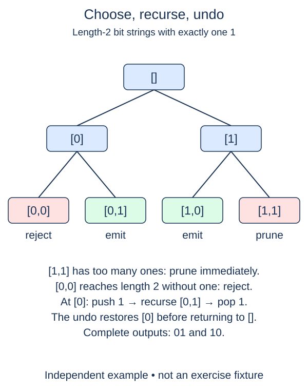

A crew packs optional tools, each with a nonnegative weight. Generate every subset whose total weight fits a capacity. This search resembles the power set, but a partial choice can rule out an entire branch before the branch reaches a leaf.

Use input indices as identities because two tools may have equal weights. Return tuples of selected indices, not tuples of weights. With weights `[4, 1]` and capacity 3, only `()` and `(1,)` fit. A zero-weight tool is still a distinct choice, so selecting it and leaving it behind produce different subsets.

Carry the current index, selected-index path, and running total. At each item, explore exclusion first, then inclusion if the new total fits. Every completed leaf records one tuple. This exclude-before-include depth-first order is explicit; it differs from ascending-mask power-set order because the first input decision changes slowest.

Pruning is safe because all weights are nonnegative. Once an inclusion would exceed the capacity, adding more tools cannot repair it. With negative weights that reasoning would be wrong, so the supplied `_budget_inputs` rejects them. It also rejects negative capacity, booleans, non-integer values, or more than eight tools. An empty input has the one empty selection for every valid capacity.

Do not generate the whole power set and filter afterward. Test a candidate total before recursing into its include branch. Besides valid selections, return an integer `visited`: count each recursive call entered, including the initial call and leaves. This diagnostic makes pruning observable without timing the computer. It is part of this function's return contract, `(selections, visited)`.

`nonlocal visited` lets a nested helper update the counter defined in its enclosing function. Without it, assigning to `visited` would create a separate local variable. The path and result lists need no such declaration when you only append or pop.

Worst-case work remains exponential: when everything fits, every branch is visited. With copied output tuples, time and output space can reach O(n 2**n); path and stack need O(n) space. A tight budget may prune much of that tree, but it does not guarantee polynomial time.

This separate example requires exactly one 1. It shows the same choose, recurse, and undo pattern as our budget search, but has a different leaf rule and output contract. Our exercise returns selected tool indices and a visited-call count.

## Build it in small steps

The exclude-first recursion and visited-call counter are supplied. Your budget predicate decides whether an include call is entered at all; it is not a filter applied after enumeration. The leaf helper copies selected indices before the driver changes the path again.

## Your Tasks

1. Complete `fits_budget(total, weight, capacity)` to allow an inclusion exactly when the new total does not exceed capacity.
2. Complete `budget_snapshot(path)` to save selected indices in an independent tuple.

Edit `main.py`. Run prints the fitting index selections and the number of search calls. Submit checks the same operation on additional small cases.
