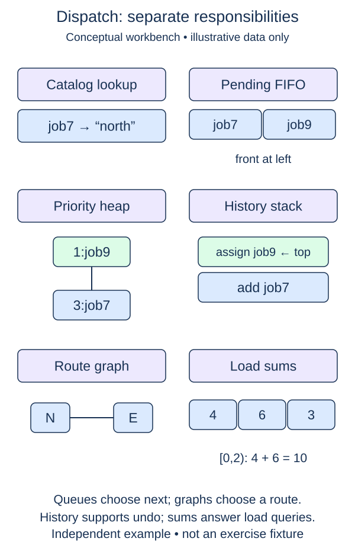

Finish the workbench with a repeatable command session. The catalog, FIFO intake, stable priorities, history stack, graph queries, weighted routes, and load index now belong to the same object. Keep all of that code; the final addition only coordinates existing operations.

The supplied `execute(command)` accepts tuples. `('register', job)` and `('enqueue', id)` call their matching methods. `('dispatch',)` and `('undo',)` change completion state. `('reachable', start, id)` and `('route', start, id)` look up the job's destination in the catalog before querying the map. `('load', start, stop)` returns a half-open load total. Unknown commands or wrong tuple lengths raise `ValueError`. An empty command is invalid too.

`run_session(workbench, commands)` lives outside the class. Process commands in order and append each result to a list. Catch only `KeyError` and `ValueError` from a rejected command, append the literal string `"error"`, and continue. Let unexpected programming errors surface instead of hiding them. Return the complete result list; the session function should not print.

For example, an unknown job can produce `"error"`, followed by a valid registration that still succeeds. A failed request should not poison later commands. Calling the same session function again with the same workbench continues its state; calling it with a fresh workbench starts independently.

The supplied `main()` constructs a small one-way network and a scripted command list. It registers three jobs, queues them, checks a catalog destination's reachability and route, dispatches in stable priority order, reports loads, undoes the last completion, and reports again. The third destination is isolated to make unreachable behavior visible. Reachability is advisory: dispatch still records that job when it reaches the front of the priority heap. This models scheduling records, not permission to send a vehicle. Run uses this script, not `input()`, files, or a network connection.

The wrapper adds O(c) result-list space for c commands; total time is the sum of the called operations. It does not make an expensive route query constant-time. The same session now exercises the structures together without depending on another lesson's files.

These panels are independent examples, not successive snapshots of `main()`. The pictured job7 and job9 are not the scripted jobs. Our script uses zeta, alpha, and later; route queries read the directed map, while dispatch records workload even for an unreachable destination.

## Supplied setup and small steps

Separate recovery from iteration. First make one command safe. Then write the short session loop. The loop test supplies a working safe-call helper, while the first test checks that unexpected programming errors still escape. The scripted `main` and command dispatcher remain supplied.

## Your Tasks

1. Complete `execute_safely(workbench, command)` to return one command result, or `"error"` for `KeyError`/`ValueError` only.
2. Complete `run_session(workbench, commands)` to collect one safe result per command in order.

Edit `main.py`. Run prints one result per scripted command, including an error followed by successful work. Submit checks the same operation on additional small cases.
