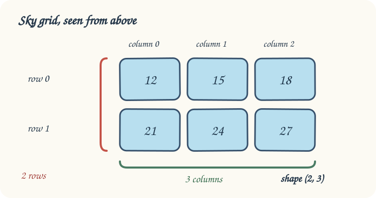

The sound board records levels in rows. Each inner list is one row; for a rectangular grid, `shape` reports `(rows, columns)`. The diagram below shows which direction each count describes.

In `main.py`, add one row to the arcade sound board. Press **Run** and watch its shape change from `(2, 2)` to `(3, 2)`, then **Submit**.

Here is a separate example: two rows of three readings have shape `(2, 3)`. The diagram labels **indices** starting at 0, but `shape` reports the **counts** of rows and columns.

## Your Task

1. Add `[7, 8]` as the sound board’s third row.
