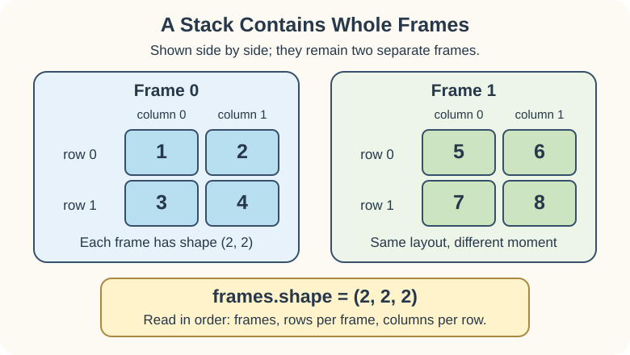

A scoreboard can keep a snapshot of its grid at each moment. One snapshot is a **frame**. A list of equally shaped frames creates a three-dimensional array.

Read the nesting from the outside in: **frames → rows → values in each row**. The starter has two frames, each with two rows and two columns, so its shape is `(2, 2, 2)`.

A third dimension doesn't have to mean physical depth. Here it records which moment the frame came from.

## Your Task

1. Add `[[9, 8], [7, 6]]` as the third frame in `frames`.

Keep the first two frames and place the new frame at the same nesting level. Run `main.py` to see `(3, 2, 2)`: the frame count changes, while the row and column counts stay the same. Submit to check the stack.
