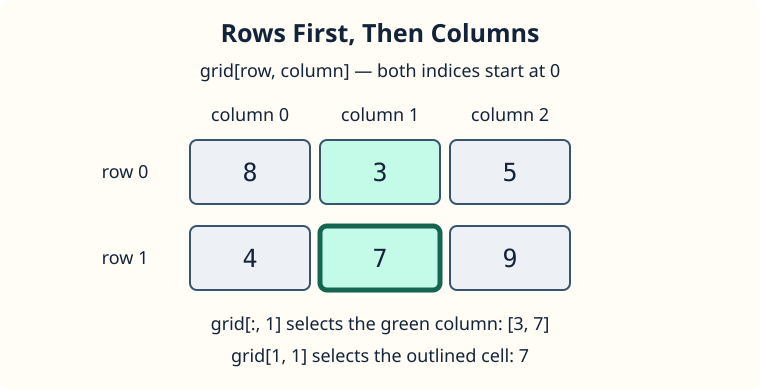

A camera stores a tiny sky map as rows and columns.

Both coordinates start at zero. In `grid[row, column]`, the position before the comma chooses the row, and the position after it chooses the column. A colon means “keep everything” in that position: `grid[row, :]` selects a whole row, while `grid[:, column]` selects a whole column.

Here, row `1` is the second row, `[4, 7, 9]`. Column `1` contains `[3, 7]`, across both rows.

## Your Task

1. Change the row index in `spot` to `1`, keeping the column at `1`.

Edit `main.py` and press **Run**. The cell should print as `7`, followed by the middle column `[3 7]`. Then **Submit** to check the new coordinates.
